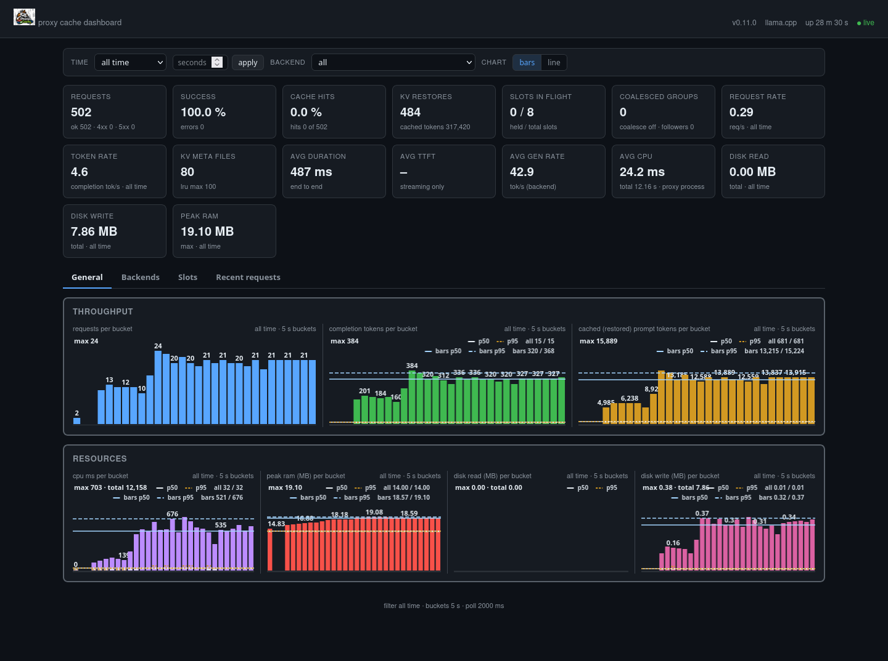
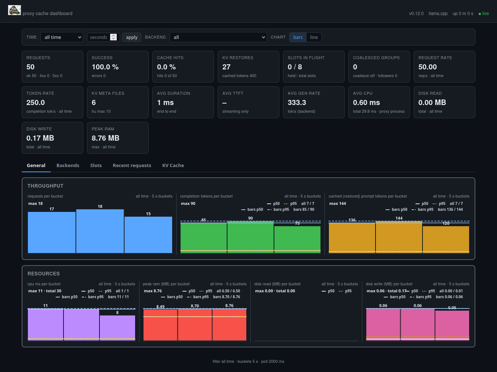
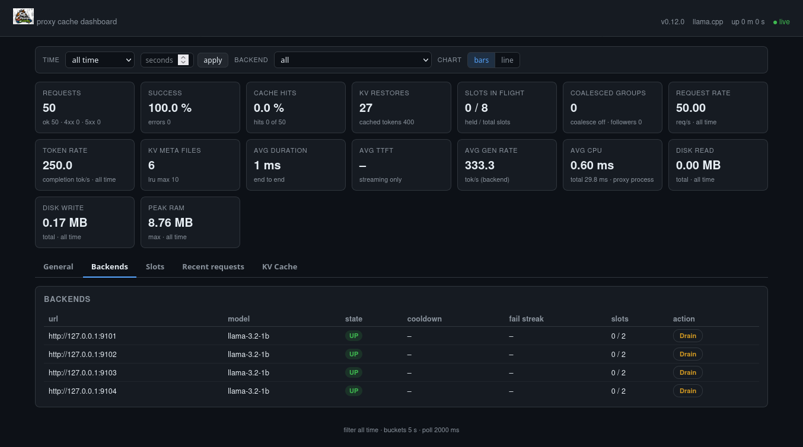
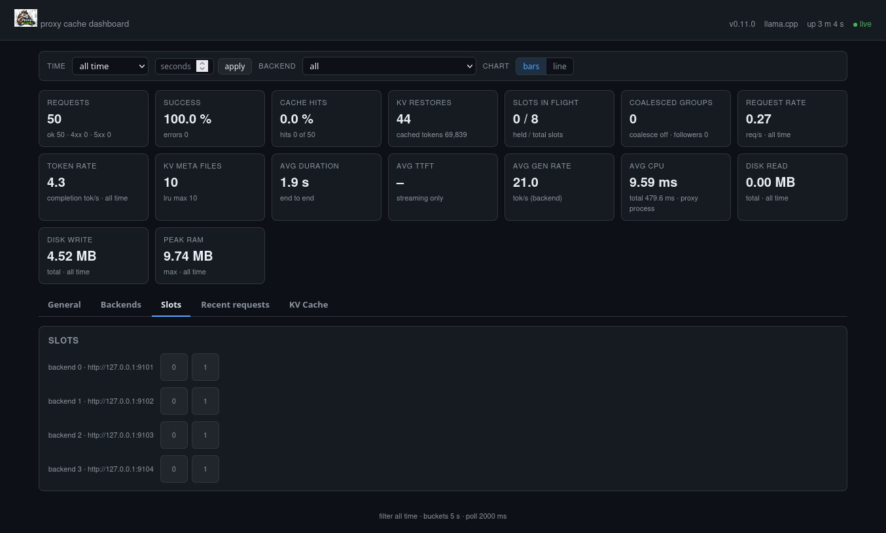
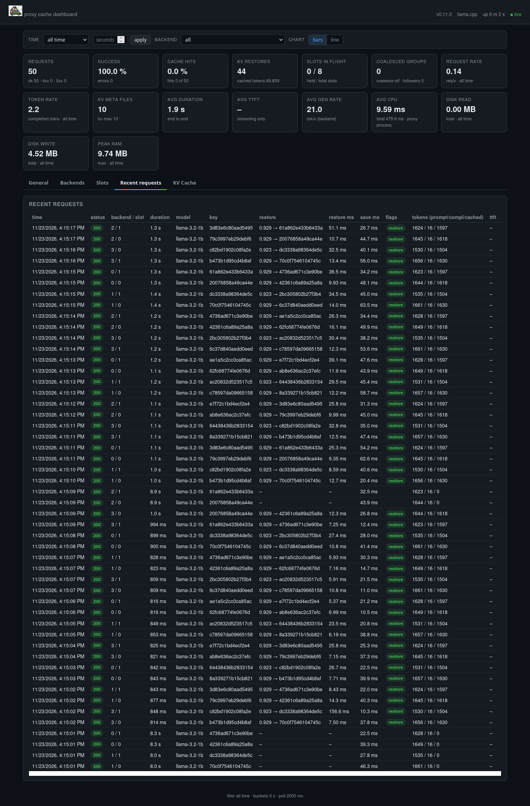
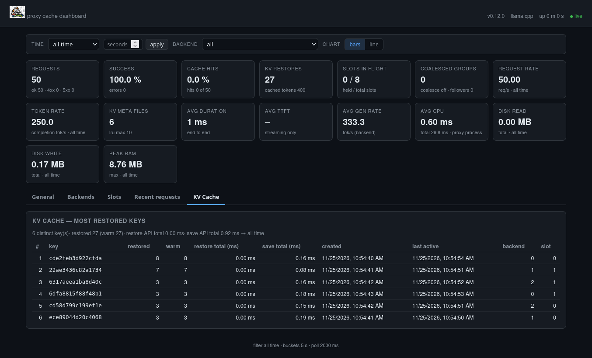

# Llama Server Proxy Cache

A KV-cache-aware, OpenAI-compatible proxy in front of one or more
**llama.cpp** servers — a from-scratch Rust rewrite of the Python
[`proxycache`](https://github.com/airnsk/proxycache) project.

It speaks OpenAI's `/v1/chat/completions` API and transparently manages
llama.cpp's slot KV caches so that long, similar prompts don't pay the
full prefill cost every time.

> 📚 **Documentation.** [Use cases](docs/use-cases.md) ·
> [Architecture](docs/architecture.md) ·
> [Setup Guide](docs/setup-guide.md) ·
> [Configurator Guide](docs/configurator-guide.md)

## How it works

1. **Request prefilter** (optional) — when a prefilter plugin is
   configured, every chat request is checked by a prefilter plugin right
   after body parsing and cache-key computation and **before**
   coalescing, slot acquisition, or backend dispatch. Prefilters come
   from the `lpcache-plugins` library and are selected by name through
   the `PLUGINS` JSON config (see below); the legacy `PREFILTER_*`
   variables keep working and are translated into the equivalent plugin
   specs when `PLUGINS` is unset. The llama.cpp backend client is
   likewise a plugin (the built-in `llama`) and is instantiated per
   `BACKENDS` entry with its URL, API key and timeout from the standard
   config.
   The built-in prefilter plugins — the **keyword blocklist**
   (`keyword`) rejects requests whose message contents contain a blocked
   keyword (plain substring match, case-insensitive by default) with a
   `400` JSON error; the **Qwen guard** (`qwen_guard`) classifies the
   request's combined message text with a separate **Qwen3Guard-Gen**
   llama-server (OpenAI-compatible `/v1/chat/completions`) and rejects
   with `400` when the verdict hits the configured `reject_levels`
   (default `["Unsafe"]`) or `reject_categories` (default none); and the
   **result cache** (`result_cache`) answers fresh
   (non-expired) same-key requests with a previously cached backend
   result stored at `{dir}/{lowercase(model_id)}_{key}.json` — fresh non-streaming results are
   stored there after the backend call; streaming requests are never
   served from the cache by default (set the plugin's `cache_streaming`
   param to `true` to also aggregate completed streaming results into a
   non-streaming completion and serve cached entries to streaming clients
   as SSE). With the plugin's `cache_control` param set to `true`, a
   request whose `Cache-Control` header carries the `no-cache` directive
   is forwarded to the backend instead of being answered from the cache.
   In both cases the request never reaches
   llama-server — no slot is acquired, no KV cache is restored or saved,
   no meta file is written, and the request never leads or joins a
   coalescing group (several plugins are chained in config order, so the
   blocklist can run first). Custom accept/reject/serve logic plugs in
   through the `Prefilter` trait from `lpcache_plugins` (register the
   factory at startup); result-cache hits can trigger a pluggable
   post-serve cleanup adapter (`PostCleanup`, e.g. the built-in
   `RemoveAfterServe` one-shot cleanup).
2. **Prefix hashing** — the concatenated message contents (roles
   stripped) are split into words (`\w+`, lowercased), chunked into blocks
   of `WORDS_PER_BLOCK` (default 100) words, and each block is SHA256-hashed.
   The cache key is `sha256(model + "\n" + raw_prefix)` — the model is the
   id the cache is addressed by: the first backend's reported model id by
   default, or the request's (lowercased) `model` with model-aware routing
   enabled (item 9).
3. **Big/small requests** — requests with more than `BIG_THRESHOLD_WORDS`
   (default 500) words are "big": they run with `cache_prompt=true` and
   their KV cache is saved to the backend after completion, with a
   `<key>.meta.json` file (block hashes, model id, wpb, timestamp) written
   to `META_DIR`. When `SKIP_SAVE_ON_SELF_RESTORE` is on (the default) the
   post-request save is skipped if the request just successfully restored
   its *own* key — a cold restore's 200 proved the KV file's presence, and
   a warm "already running" no-op restore skips the save while the key's
   meta file is still on disk (a missing meta file makes the save re-write
   the pair, healing it); a ratio-1.0 *prefix* match (a multi-turn
   extension) is not a self-restore and still saves.
4. **Restore candidates** — before a big request, the proxy scans the meta
   files and looks for one with the same model and `wpb` whose block list
   shares the longest common prefix; if the LCP ratio is at least `LCP_TH`
   (default 0.1), that cache is restored into the chosen slot *before* the
   chat is dispatched. If the chosen slot is already running that KV cache
   (the proxy tracks the last key each slot loaded, via a successful
   restore or save), the restore call is skipped entirely
   (`restore_skipped ... reason=already_running`) — llama.cpp keeps the
   slot's KV across requests. A backend entry in `BACKENDS` can set
   `"kv_cache": false` (default `true`) to opt out: restores are only ever
   issued to slots of `kv_cache`-enabled backends, and a request served by
   a disabled backend neither saves its KV cache nor writes a meta file —
   use this for backends without slot save/restore support (e.g.
   llama-server < 1.05.40).
5. **Slot management** — every llama.cpp slot is guarded by a lock.
   The proxy prefers an idle slot already running the request's
   KV cache key (the default `SLOT_ROUTING_POLICY=key_affinity`),
   otherwise picks a never-used slot first, then the
   least recently used one (`SLOT_ROUTING_POLICY=lru`), and
   waits up to 300 s for it
   (`503 all slots busy` on timeout), and releases it when the
   response is fully handled.
6. **Streaming** — SSE responses are passed through byte-for-byte via a
   background reader task; the reader's cleanup step always saves the KV
   cache and writes the meta file, then releases the slot.
7. **Bounded cache** — after each save the proxy keeps at most `META_MAX`
   (default 10) meta files: the oldest ones (by last save/restore
   timestamp) are deleted, together with the KV files of the same name in
   the configured `--slot-save-path` directories. `META_MAX=0` disables
   pruning. A later restore of a pruned key simply fails and falls back to
   a full prefill. At startup, corrupt `.meta.json` files in `META_DIR`
   are removed (and, with `STARTUP_CLEANUP_KV=true`, the orphan KV files
   of the removed metas as well).
8. **Request log** (optional) — when `REQUEST_LOG` is enabled, every
   finished request (including failed ones) becomes one W3C Extended Log
   Format (XLF) record appended to a size-rotated file — see [Request
   log](#request-log).
9. **Model-aware routing** (optional) — a `BACKENDS` entry can carry a
   `model_id`. The field is **all-or-nothing**: set on every backend or on
   none (a mixed set is a startup error, named per backend). When it is set
   on every backend, the request's `model` must match one of the configured
   ids (case-insensitive) or the request is rejected with `404 model not
   found` (the error lists the available ids); requests then only run on
   matching backends, `GET /v1/models` advertises the configured ids
   instead of `MODEL_ID`, and the KV cache files are named
   `{lowercase(model_id)}_{key}` so different models' caches never collide
   in a shared `--slot-save-path` dir. Without `model_id`s (the default)
   behaviour is unchanged.

## Stack

Rust 2024, `axum` 0.8 + `tokio` + `reqwest` (rustls) + `serde` + `sha2` +
`tracing`. The slot pin is duplicated in the request body root, `options`
and the query string (llama.cpp accepts it in several places depending on the build).

## Configuration

> 🛠 Prefer a guided setup? The bundled **`lpcache-config`** configurator
> offers one-shot CLI commands, an interactive wizard (`configure`) and a
> web UI (`serve`) to build, validate and export the configuration below —
> see the [Configurator Guide](docs/configurator-guide.md).

| Variable            | Default             | Meaning                                        |
|---------------------|---------------------|------------------------------------------------|
| `BACKENDS`          | —                   | JSON array `[{\"url\": \"...\", \"n_slots\": N, \"slot_save_path\": \"...\", \"kv_cache\": true, \"model_id\": \"...\"}, ...]` (per-backend `kv_cache` gates KV save/restore; per-backend `model_id` enables model-aware routing — all-or-nothing; see [How it works](#how-it-works)) |
| `LLAMA_URL`         | `http://127.0.0.1:8000` | fallback single backend when `BACKENDS` unset |
| `N_SLOTS`           | `1`                 | fallback slot count per backend                |
| `WORDS_PER_BLOCK`   | `100`               | words per hash block                           |
| `BIG_THRESHOLD_WORDS` | `500`             | word count above which a request is "big"      |
| `LCP_TH`            | `0.1`               | minimum LCP block ratio to restore a cache     |
| `SKIP_SAVE_ON_SELF_RESTORE` | `true`        | skip the post-request KV save when the request successfully restored its own key (a cold restore's 200 proved the file's presence; a warm "already running" no-op restore skips while the key's meta file is still on disk, and re-saves to heal it when the meta is gone; ratio-1.0 prefix matches, i.e. multi-turn extensions, still save) |
| `META_DIR`          | `./kv_meta`         | where `<key>.meta.json` files live             |
| `META_MAX`          | `10`                | max meta files kept (LRU); 0 = unlimited       |
| `STARTUP_CLEANUP_KV`| `false`             | the startup meta scan also removes the orphan KV files of removed corrupt metas (the corrupt meta files themselves are always removed) |
| `SLOT_SAVE_PATH`    | —                   | backend's `--slot-save-path` dir (single-backend fallback); pruned KV files are removed from it |
| `REQUEST_TIMEOUT`   | `600` (s)           | per-request timeout to the backend             |
| `MODEL_ID`          | `llama.cpp`         | model id advertised by `/v1/models` and used as default |
| `PORT`              | `8081`              | proxy listen port (0.0.0.0)                    |
| `LLAMA_API_KEY`     | —                   | sent to the backend as `Authorization: Bearer <KEY>` (blank = no auth) |
| `LOG_LEVEL`         | `INFO`              | log level (`RUST_LOG` overrides it)            |
| `STREAM_QUEUE_SIZE` | `16`                | per-request SSE channel capacity (must be >= 1) |
| `COALESCE_REQUESTS` | `false`             | group concurrent same-cache-key requests into one backend call (Rust-only) |
| `SLOT_ROUTING_POLICY` | `key_affinity`    | slot pick policy: `key_affinity` (prefer an idle slot already running the request's KV key, so the restore is a no-op) or `lru` (free-first, then LRU) |
| `PLUGINS` | — | JSON **array** of plugin specs `[{"name": "...", "params": {...}}]` — built-in names: `keyword`, `qwen_guard`, `result_cache`, `chain` (prefilters, chained in list order; empty array = no prefilter), `request_log` (the request logger — a spec here takes precedence over the `REQUEST_LOG*` variables below), `payload_log` (the raw request-payload logger — a spec here takes precedence over `REQUEST_PAYLOAD_DIR` below, at most one) and `dashboard` (the real-time statistics web page, at most one); when unset, the legacy `PREFILTER_*` variables below are translated into the equivalent prefilter specs (when set, `PLUGINS` takes precedence over them) |
| `REQUEST_LOG` | `false` | when true, one W3C-XLF record per finished request is appended to the request-log file (the built-in `request_log` plugin) |
| `REQUEST_LOG_PATH` | `lpcache-request.log` | request-log file location; relative paths resolve against the CWD (the parent dir is created) |
| `REQUEST_LOG_MAX_BYTES` | `10485760` (10 MiB) | rotation threshold in bytes; the file is rotated when exceeded (`<path>.1`, `<path>.2`, …); `0` = no rotation |
| `REQUEST_LOG_KEEP` | `5` | rotated generations retained (the oldest is dropped); `0` = keep them all |
| `REQUEST_LOG_FIELDS` | all 36 fields | comma-separated ordered subset of the known XLF field names (W3C fields + `lpcache-*` pipeline/performance/resource fields — see [Request log](#request-log)) |
| `REQUEST_PAYLOAD_DIR` | — | when set, each chat request's raw payload (plus its HTTP headers in a paired `.headers` file) is written to a unique file in this directory as it arrives — before parsing, prefiltering or backend dispatch, so malformed and rejected requests are captured too (the built-in `payload_log` plugin — see [Payload log](#payload-log)) |
| `PREFILTER_BLOCKLIST` | —                 | **legacy** (synthesized into a `keyword` plugin when `PLUGINS` is unset): comma-separated keywords; requests whose message contents contain any are rejected with `400` before the backend (default: no prefilter) |
| `PREFILTER_CASE_INSENSITIVE` | `true`     | **legacy**: keyword matching is case-insensitive           |
| `PREFILTER_RESULT_CACHE_DIR` | —          | **legacy** (synthesized into a `result_cache` plugin when `PLUGINS` is unset): cache-result path (`{lowercase(model_id)}_{key}.json` per cache key); fresh same-key requests are answered from the cached backend result before the backend (default: disabled) |
| `PREFILTER_RESULT_CACHE_TTL` | `300` (s)    | **legacy**: per-entry result-cache expiry; `0` = never expires |
| `SAVE_RETRIES` | `3`                 | retries after a failed KV cache save (backend 500 or other error); `0` = no retry |
| `SAVE_RETRY_DELAY_MS` | `1000` (ms)   | delay between KV cache save retry attempts          |

Every variable is also available as a command-line flag (see
`./target/release/lpcache --help`): `--backends`, `--llama-url`,
`--n-slots`, `--words-per-block`, `--big-threshold-words`, `--lcp-th`,
`--skip-save-on-self-restore`,
`--meta-dir`, `--meta-max`, `--slot-save-path`, `--request-timeout`,
`--model-id`, `--port`, `--api-key` (→ `LLAMA_API_KEY`), `--log-level`,
`--stream-queue-size`,
`--coalesce-requests`, `--plugins` (→ `PLUGINS`),
`--request-log` (→ `REQUEST_LOG`),
`--request-log-path` (→ `REQUEST_LOG_PATH`),
`--request-log-max-bytes` (→ `REQUEST_LOG_MAX_BYTES`),
`--request-log-keep` (→ `REQUEST_LOG_KEEP`),
`--request-log-fields` (→ `REQUEST_LOG_FIELDS`),
`--request-payload-dir` (→ `REQUEST_PAYLOAD_DIR`),
`--prefilter-blocklist` (→ `PREFILTER_BLOCKLIST`, legacy),
`--prefilter-case-insensitive` (→ `PREFILTER_CASE_INSENSITIVE`, legacy),
`--prefilter-result-cache-dir` (→ `PREFILTER_RESULT_CACHE_DIR`, legacy),
`--prefilter-result-cache-ttl` (→ `PREFILTER_RESULT_CACHE_TTL`, legacy),
`--save-retries` (→ `SAVE_RETRIES`),
`--save-retry-delay-ms` (→ `SAVE_RETRY_DELAY_MS`).
`-h`/`--help` shows the full help; `-V`/`--version` prints the proxy version
(also logged in the `app_start` line at startup).
Explicit flags take precedence over environment variables, which take
precedence over the built-in defaults:

```bash
./target/release/lpcache --llama-url http://127.0.0.1:8000 --n-slots 1 \
  --port 8081 --meta-dir ./kv_meta --log-level INFO
```

> 📖 **Plugins in depth.** The table above lists the `PLUGINS` names and the
> legacy `PREFILTER_*`/`REQUEST_LOG*` variables. For full plugin behavior,
> edge cases, worked examples and a live Llama-3.2-1B run, see
> [PLUGINS.md](PLUGINS.md).

## Request log

When `REQUEST_LOG=true` — or a `request_log` spec is listed in `PLUGINS`
(which takes precedence) — the built-in `request_log` plugin appends one
[W3C Extended Log Format (XLF)](https://www.w3.org/TR/xlf-10/) record per
**finished** request to `REQUEST_LOG_PATH`: successes, errors, and client
disconnects (the record is written when the response body completes or is
dropped). The file starts with:

```text
#Software: lpcache-plugins/<version>
#Version: 1.0
#Date-format: %Y-%m-%dT%H:%M:%S.%fZ
#Fields: datetime cs-method cs-uri ... lpcache-reason
```

Default fields (W3C fields first, then lpcache pipeline fields, then
lpcache performance fields, then lpcache resource fields —
`REQUEST_LOG_FIELDS` selects an ordered subset): `datetime`, `cs-method`,
`cs-uri`, `c-ip`, `cs(User-Agent)`, `cs-bytes`, `cs-time`, `sc-status`,
`sc-bytes`, `lpcache-model`, `lpcache-stream`, `lpcache-key`,
`lpcache-n-words`, `lpcache-is-big`, `lpcache-backend`, `lpcache-slot`,
`lpcache-restored`, `lpcache-restore-call`, `lpcache-restore-candidate`,
`lpcache-lcp-ratio`, `lpcache-cache-hit`,
`lpcache-coalesced`, `lpcache-reason`, `lpcache-prompt-tokens`,
`lpcache-completion-tokens`, `lpcache-cached-tokens`,
`lpcache-prefill-ms`, `lpcache-gen-ms`, `lpcache-prefill-tps`,
`lpcache-gen-tps`, `lpcache-ttft-ms`, `lpcache-cpu-ms`,
`lpcache-disk-read-bytes`, `lpcache-disk-write-bytes`,
`lpcache-ram-bytes`, `lpcache-peak-ram-bytes`.

- Missing values render as `-` (XLF "not available"); values containing
  whitespace, a quote, or a backslash — or starting with `-`/`"` — are
  quoted and escaped per XLF.
- **Performance fields**: `lpcache-prompt-tokens` /
  `lpcache-completion-tokens` / `lpcache-cached-tokens` come from the
  backend's `usage` (the last one is the prompt tokens served from the
  backend's KV cache — the per-request effect of a restore);
  `lpcache-prefill-ms`, `lpcache-gen-ms`, `lpcache-prefill-tps` and
  `lpcache-gen-tps` come from the `timings` object llama.cpp appends to
  every chat completion (backend-side prefill/generation time and
  throughput). `lpcache-ttft-ms` is measured by the proxy (streaming
  only): time from stream start to the first SSE chunk. All of them
  render `-` when the backend did not report them (failure paths,
  non-chat requests, backends without `timings`).
- **Resource fields**: `lpcache-cpu-ms`, `lpcache-disk-read-bytes` and
  `lpcache-disk-write-bytes` are the proxy process's own CPU time and
  disk I/O during the request (process-wide counters, so approximate
  under concurrency); `lpcache-ram-bytes` /
  `lpcache-peak-ram-bytes` are its resident memory and peak resident
  memory when the request completed (point-in-time values). All render
  `-` where the platform cannot sample them.
- **Rotation**: when the file grows beyond `REQUEST_LOG_MAX_BYTES` it is
  renamed to `<path>.1`, older generations shift upward (`<path>.2`,
  …), and at most `REQUEST_LOG_KEEP` generations are retained (the oldest
  is dropped). `max_bytes=0` disables rotation; `keep=0` keeps all
  generations. The fresh current file starts with a new XLF header.
- Request-log I/O failures are logged and swallowed — logging never breaks
  request serving.
- `lpcache-reason` is `-` on success, otherwise a short pipeline outcome:
  `prefilter_reject`, `slot_timeout`, `backend_unreachable`,
  `backend_error`, `provider_http_<status>`, `provider_non_object`,
  `coalesce_leader_failed`, `save_failed`.
- Caveats: `c-ip` is only populated when the proxy is served over a real
  socket (Axum `ConnectInfo`); `cs-bytes` is taken from the request's
  `Content-Length` header, so chunked requests without one log `-`.

```bash
BACKENDS='[{"url":"http://127.0.0.1:8000","n_slots":4}]' \
  REQUEST_LOG=true REQUEST_LOG_PATH=/var/log/lpcache/req.log \
  REQUEST_LOG_MAX_BYTES=10485760 REQUEST_LOG_KEEP=5 ./target/release/lpcache
```

## Payload log

When `REQUEST_PAYLOAD_DIR` is set — or a `payload_log` spec is listed in
`PLUGINS` (which takes precedence) — the built-in `payload_log` plugin writes
each `POST /v1/chat/completions` request's **raw payload** (plus its HTTP
headers) to unique files in that directory as it arrives: before JSON parsing,
prefiltering or backend dispatch, so malformed and rejected requests are
captured too.

File names: `{dir}/{seq:06}-{timestamp}-{key16}.json` (`.bin` for non-UTF-8
payloads) paired with `{same base name}.headers` (one `name: value` line per
request header, names lowercased, in wire order), where `seq` is a per-process
counter, `timestamp` the UTC receive time (`%Y-%m-%dT%H-%M-%S.%fZ`, colons
replaced by dashes) and `key16` the first 16 hex chars of the request's KV
cache key (`nokey` when the payload could not be parsed, so the key was never
computed). Relative paths resolve against the CWD; the directory is created at
startup. The files are never rotated or deleted by the proxy — payloads and
headers may contain sensitive data (messages, system prompts, `Authorization`
values), so prune the directory as you would any log. Payload-write failures
are logged and swallowed — logging never breaks request serving. At most one
`payload_log` plugin.

```bash
BACKENDS='[{"url":"http://127.0.0.1:8000","n_slots":4}]' \
  REQUEST_PAYLOAD_DIR=/var/log/lpcache/payloads ./target/release/lpcache
```

## Dashboard

Add a `dashboard` spec to `PLUGINS` (at most one) to enable the built-in
`dashboard` plugin: a **self-contained** real-time statistics web page
(inline CSS + JS, no external assets — safe for the air-gapped boxes this
usually runs on). The proxy mounts two routes from the plugin:

- `GET {path}` (default `GET /dashboard`) — the HTML page
- `GET {path}/api/stats` — the JSON payload the page polls: the proxy's
  live state (slot occupancy per backend/slot, circuit-breaker state incl.
  the per-backend drain flag,
  in-flight count, active coalesced groups, KV meta cache size, uptime)
  merged with the plugin's per-request aggregates (lifetime counters,
  success rate, process resource totals — the proxy's own CPU ms, disk
  bytes read/written and peak RAM — a per-bucket time series, and the
  recent-requests ring).
  The endpoint accepts an optional `?since=<unix seconds>` query
  parameter that scopes the aggregates to `[since, now]` (served as
  `range.counters` plus the range's time series, coarsened to at most
  360 points so long ranges stay cheap) and an optional
  `?backend=<index|cached|coalesced|coalesced_groups>` query parameter
  that restricts them to the records that ran on one backend, or (with
  `cached`) to the records served from the result cache, (with
  `coalesced`) to the coalesced followers, or (with
  `coalesced_groups`) to every request of the coalesced groups — the
  cache-served, coalesced records never touch a backend, and the
  leaders count in both their group's and their backend's scope, so the
  scopes are views, not a partition (absent = all backends — no
  filtering, every statistic includes all of them); without `?since`
  the payload is the lifetime counters plus the trailing `window_secs`
  series

The page polls the stats endpoint and renders KPI cards (incl. the
proxy's CPU / disk / RAM metrics) at the top, and a tabbed panel below
them: the **General** tab (shown by default) holds the throughput panel
(requests, completion tokens and cached tokens per bucket) and a
resources panel (the proxy's own CPU ms, disk bytes read/written and peak
RAM per bucket), while the **Backends**, **Slots**, **Recent requests**
and **KV Cache** tabs hold the per-backend table (with a **Drain /
Resume** action column per row — a drained backend shows a `DRAINED`
badge and is excluded from new requests until resumed; the buttons POST
to the proxy's own `/_control/backends/<i>/drain|resume` endpoints), the
slot-occupancy
grid, the recent-requests table (which carries the backend index, slot
and the KV-restore / KV-save API call durations of each request) and a
per-key KV table (each distinct restored or saved request key with its
restore count and the cumulative restore/save API call durations, sorted
by the highest restore count) — only one tab
is visible at a time. Every throughput/resource chart
also overlays the percentile lines of its metric — per-request p50
(solid) / p95 (dashed) ticks on each bar, the window-wide per-request
p50/p95 as full-width lines, and the p50/p95 of the plotted per-bucket
aggregate values — with a two-row legend (the per-request p50/p95 on the
first row, the drawn-bars p50/p95 on the second; clicking an item toggles
its lines; hidden lines are dropped from the scale); the additive
resource charts (cpu ms, disk read, disk write) additionally draw the
window total next to the max in the top-left corner.
A chart-style switch (bars / line) in the filter bar re-renders every
chart in the selected style — bars (default, one bar per bucket) or a
line through the per-bucket values (with point dots while the buckets
are sparse).
A time-filter dropdown, grouped into presets (30 seconds, 1 minute,
5 minutes, 15 minutes) and other (custom time, all time), and a
backend-filter dropdown (default: `all` — no filtering; an index, or
the `cached`, `coalesced` or `coalesced_groups` option for the
result-cache, coalesced-follower and coalesced-group records) scope
the cards, charts and recent table to the selected range and backend
by polling with
`?since=<unix seconds>&backend=<index|cached|coalesced|coalesced_groups>`.
The page's own URL accepts the same `?backend=` values, so a filtered
view can be deep-linked.

Plugin params (all optional):

| Param | Default | Meaning |
|---|---|---|
| `path` | `/dashboard` | page URL path (must start with `/`); the stats API is `{path}/api/stats` |
| `refresh_ms` | `2000` | the page's poll interval in ms (100..=3600000) |
| `window_secs` | `300` | trailing window for a stats poll without `?since` (10..=86400) |
| `bucket_secs` | `5` | time-series bucket size in seconds (1..=3600) |
| `max_recent` | `100` | recent-requests ring size per backend scope (0 disables the table; ≤ 10000) |

Every **finished** request — success, error, rejection or client
disconnect — is fed to the dashboard through the same middleware that
feeds the request log, so the aggregates cover non-chat routes as well.
The dashboard's own routes (the page and the stats API) are excluded
from both the aggregates and the request log, so the page's polling
never inflates the statistics.



```bash
PLUGINS='[{"name":"dashboard","params":{"path":"/dashboard","refresh_ms":1000}}]' \
  ./target/release/lpcache
# → open http://<proxy-host>:<port>/dashboard
```

### Live dashboard — 4 backends, 8 slots, one shared KV folder (Sample)

The five screenshots below come from a single deterministic run against the
built-in mock llama.cpp backend (`examples/mock_llama` — the same server
the test suite runs against), so the shot can be reproduced exactly (repro
steps at the end of this section). The topology:

- **4 backend instances** — `mock_llama` serving model `llama-3.2-1b`,
  2 slots each, on ports 9101–9104, so the proxy pins **8 slots** in total;
- **one shared KV folder** — every mock was started with the same KV save
  dir (its third argument emulates the backend's `--slot-save-path`), and
  the proxy was given the same directory as `SLOT_SAVE_PATH`, so a KV cache
  saved while a request ran on one backend can be restored into a slot on
  any of the other three;
- **model-aware routing** — every `BACKENDS` entry carries
  `model_id: "llama-3.2-1b"` (all-or-nothing), so the requests' `model`
  field must match and the per-row **model** column shows it;
- **default `SLOT_ROUTING_POLICY=key_affinity`** — a request with a KV
  restore key prefers an idle slot already running that key, so the restore
  is a *warm* no-op (no backend wire call at all).

The load is **50 non-streaming chat requests** dispatched by **4 concurrent
workers** with a random 150–450 ms wait between dispatches, drawn from 9
fixed prompts: 4 documents of 1,700 words and 5 follow-ups of 460 / 540 /
500 / 470 / 530 words. Three follow-ups sit at or below the 500-word
`BIG_THRESHOLD_WORDS` threshold, so only 6 of the 9 prompts — the 4
documents plus the 540- and 530-word follow-ups — qualify for KV
save/restore (33 of the 50 requests are "big"). Each big key's first
occurrence saves; every later occurrence restores it. The mock answers in
~1 ms with a fixed `usage` block (10 prompt / 5 completion / 8 cached
tokens, 333.3 gen tok/s), which is why the durations and token counts
below are small and uniform.

**General tab** (the default view, time filter set to *all time*):



The KPI cards show the run's outcome: 50 requests, 100 % success (errors
0), **27 KV restores** (all *warm*) with 400 cached prompt tokens, 6 KV
meta files (under `META_MAX=10`, so nothing was pruned), 0/8 slots in
flight (the load had finished when the shot was taken), an average
end-to-end duration of 1 ms (mock) and the proxy's own footprint — average
CPU 0.60 ms per request (29.8 ms total), disk writes 0.17 MB (the KV slot
files landing in the shared folder), peak RAM 8.76 MB. The **throughput**
panel plots the run as 5-second buckets — 17 / 18 / 15 requests, 85 / 90 /
75 completion tokens, and 136 / 144 / 120 *cached (restored) prompt
tokens* per bucket — and the **resources** panel the proxy's own per-bucket
CPU ms, peak RAM and disk I/O. Every chart overlays its p50/p95 percentile
lines as described above, and the filter bar's **bar / line** toggle
re-draws the same bars as a continuous line.

**Backends tab**:



The per-backend table: all four URLs `UP`, the **model** column showing
each backend's `model_id` (`llama-3.2-1b`), no cooldown, no failure streak,
and `0 / 2` busy slots each (idle after the run; during the run this column
tracks the 4 concurrent requests). The **action** column carries the
per-backend **Drain** / **Resume** control (a drained row shows a `DRAINED`
badge instead of `UP` and its button flips to **Resume** — see [§4 Runtime
backend control](PARAMETERS.md#4-runtime-backend-control-no-configuration)).

**Slots tab**:



The slot-occupancy grid: backend 0–3 × slot 0–1 — the 8 cells the proxy
pins across the 4 instances, all idle after the run.

**Recent requests tab** (50 rows, *all time* filter):



One row per finished request, newest first. Reading bottom-up, the six
first occurrences of the big keys (interleaved with the small-key rows,
which never cache) carry no restore candidate yet (`—` in the *restore*
column) and record a *save* duration (0.08–0.19 ms — the mock's save API
call); their KV was written to the shared folder afterwards. Every later
row for a big key is a **warm** restore: the *restore* column shows the LCP
candidate ratio (1.000 — an exact key match) and the key, while *restore
ms* is `—` because `key_affinity` picked a slot that already ran the key
and the backend restore was skipped entirely — a warm restore makes no wire
call, and `SKIP_SAVE_ON_SELF_RESTORE` (default `true`) skips the
post-request re-save too. The *tokens* column shows the mock's fixed usage
— `10 / 5 / 8` prompt / completion / cached — and the *backend / slot*
column shows the requests spread across all 8 slots of the 4 backends.

**KV Cache tab**:



The per-key table, sorted by restore count: 6 distinct keys (the big
prompts), 27 restores in total — **all warm** — restore API total 0.00 ms
(every restore was a zero-wire-call skip) vs save API total 0.92 ms. The
*backend* / *slot* columns show where each key was last active — spread
across all four backends, which only works because they share one KV
folder. The table tracks keys in memory for the proxy's lifetime, while the
on-disk meta files are pruned at `META_MAX` (10 here, so all 6 remain).

To reproduce the run:

```bash
# 4 mock backends, 2 slots each, one shared KV save dir (the mock's third
# argument emulates the backend's --slot-save-path)
for p in 9101 9102 9103 9104; do
  ./target/release/examples/mock_llama $p llama-3.2-1b ./kv &
done

BACKENDS='[{"url":"http://127.0.0.1:9101","n_slots":2,"model_id":"llama-3.2-1b"},
           {"url":"http://127.0.0.1:9102","n_slots":2,"model_id":"llama-3.2-1b"},
           {"url":"http://127.0.0.1:9103","n_slots":2,"model_id":"llama-3.2-1b"},
           {"url":"http://127.0.0.1:9104","n_slots":2,"model_id":"llama-3.2-1b"}]' \
SLOT_SAVE_PATH=./kv META_DIR=./kv_meta \
PLUGINS='[{"name":"dashboard","params":{"path":"/dashboard"}}]' \
  ./target/release/lpcache
# → open http://<proxy-host>:8081/dashboard, then send 50 chat requests
#   with "model": "llama-3.2-1b" (the shots' load: 9 fixed prompts,
#   4 concurrent workers, 150–450 ms between dispatches)
```

## Build & run

> 📖 **New here?** Start with the full [Setup Guide](docs/setup-guide.md) —
> llama.cpp flags, single/multi-backend configuration, client setup,
> verification, systemd, and troubleshooting.

```bash
cargo build --release
BACKENDS='[{"url":"http://127.0.0.1:8000","n_slots":4}]' \
  PORT=8081 META_DIR=./kv_meta ./target/release/lpcache
```

Example client:

```bash
curl http://127.0.0.1:8081/v1/chat/completions \
  -H 'content-type: application/json' \
  -d '{"model":"llama.cpp","stream":true,"messages":[{"role":"user","content":"Hello!"}]}'
```

## Smoke test without a real model

A mock llama.cpp server is included (`/v1/models`, `/v1/chat/completions`
with JSON or SSE, and `/slots/:id?action=save|restore`):

```bash
# terminal 1
cargo run --example mock_llama -- 8100 mock-model

# terminal 2
BACKENDS='[{"url":"http://127.0.0.1:8100","n_slots":2}]' \
  PORT=8091 META_DIR=/tmp/kv_meta LOG_LEVEL=DEBUG cargo run
```

Send a prompt with >500 words, then send the same prompt with a few extra
words appended — the second request logs
`restore_candidate ... ratio=1.000` / `restore_before_chat ... ok=true`.

## Tests

The suite spans the core proxy (`lpcache`), the adapter plugin library
(`lpcache-plugins`) and the configurator (`lpcache-config`) across unit,
integration and doc tests — **358 passing tests** plus **2 ignored** doc
tests:

| Suite | Location | Tests | Command |
| --- | --- | ---: | --- |
| Core proxy units | `src/` | 123 | `cargo test -p lpcache --lib` |
| Plugin library units | `plugins/src/` | 114 | `cargo test -p lpcache-plugins --lib` |
| Proxy integration (end-to-end) | `tests/api.rs` | 77 | `cargo test -p lpcache --test api` |
| Backend-client integration | `tests/client.rs` | 15 | `cargo test -p lpcache --test client` |
| Configurator units | `configurator/src/` | 29 | `cargo test -p lpcache-config` |
| Plugin doc tests | `plugins/src/` | 3 (1 + 2 ignored) | `cargo test -p lpcache-plugins --doc` |

Everything runs at once with `cargo test --workspace`. Narrow the run with a
name filter (e.g. `cargo test -p lpcache --test api restore`) or add
`-- --ignored` to also execute the ignored doctests.

### Core proxy units — `lpcache` (123, `src/`)

Unit tests live in `#[cfg(test)]` modules next to the code they cover.

- **Config & CLI** (`config.rs`, 44): defaults and env fallbacks
  (`META_DIR`, `META_MAX`, `SLOT_SAVE_PATH`, `API_KEY`, non-numeric values),
  `BACKENDS` JSON parsing (incl. per-backend `slot_save_path` / `kv_cache`
  / `model_id`, invalid-JSON fallback), the per-backend `model_id`
  all-or-nothing rule (mixed set is a startup error naming the offending
  entries) and `model_routing_enabled` / `available_model_ids`, full CLI
  parsing (space/equal forms, extra `=`, last-wins, unknown/missing flags,
  `--help`/`--version`, usage text), CLI-over-env-over-default precedence,
  the `SLOT_ROUTING_POLICY`
  env/CLI parsing (`key_affinity` default, `lru`, `key_affinity` /
   `key-affinity` spelling variants,
  invalid → default with a warning) and `PLUGINS` / legacy
  `PREFILTER_*` / `REQUEST_LOG*` / `REQUEST_PAYLOAD_DIR` spec synthesis and
  precedence.
- **Hashing & meta files** (`hashing.rs`, 24): raw-prefix construction
  (join/strip, empty/missing, non-string content), word tokenization, block
  hashing, LCP ratio, SHA256 known vectors, meta-file round-trip and scanning
  (corrupt/extension/missing-dir), timestamp bump, restore-candidate
  filtering/thresholds and best-ratio pick, LRU meta pruning (incl. the
  pruned entry's model id for KV-file removal), startup corrupt-meta
  cleanup (`clean_corrupt_meta`), and the model-prefixed KV
  cache filename (`kv_basename`).
- **Coalescing / single-flight** (`coalesce.rs`, 5): leader/follower entry,
  group forget, finish waking waiters with the outcome (incl. the
  early-finish wakeup race), ordered SSE append/drain.
- **Slot management** (`slot_manager.rs`, 44): slot selection and ordering
  (free-first, used-then-oldest, multi-backend, idle-aware, and the
  `key_affinity` key-free tier — an idle slot already running the
  requested key is picked before the free/LRU tiers), model-aware
  routing (requests only target slots of backends serving their model,
  the last-used slot of other models stays usable), restore
  targeting and retry-slot exclusion (only `kv_cache`-enabled backends),
  per-slot last-KV tracking (a restore is skipped when the picked slot
  already runs the requested key; the tracking is updated by successful
  restores/saves and cleared by failed restores), save semantics with
  auto-retry (500 vs other errors, retries until success / exhausted /
  disabled), per-slot locking and acquire timeout, and the circuit breaker
  (skip while others up, all-down fail-open, cooldown expiry, escalating
  backoff, success/probe recovery) and the runtime drain control
  (drain/resume: unconditional exclusion — even the all-down fail-open
  path — success/probe no-ops, probe-based re-join).
- **Process sampling** (`procsample.rs`, 6): `/proc` status/io parsing
  (the memory gauges and disk counters; other/malformed lines ignored),
  saturating per-field delta, and live-sampling monotonicity.

### Plugin library units — `lpcache-plugins` (114, `plugins/src/`)

- **Registry** (`registry.rs`, 11): builtin registration and idempotent
  global registry, custom-plugin registration, unknown/wrong-kind errors,
  loader kind filtering, zero/one/many `load_prefilters` / `load_dashboard` /
  `load_payload_loggers` chaining, error propagation, `PluginSpec` parsing.
- **`keyword`** (`keyword.rs`, 11): match/accept, case-insensitive default,
  scans all messages, content-part arrays, empty messages, message-text
  flattening, comma-list parsing, trait-object dispatch, factory build and
  empty/missing-keyword rejection.
- **`qwen_guard`** (`qwen_guard.rs`, 17): model-card output parsing
  (case/whitespace tolerant, category aliases), level-then-category decision
  policy, safe acceptance, bounded verdict LRU + per-key reuse, reject/accept
  checks, fail-open/fail-closed, HTTP-error routing to `on_error`,
  empty-text skip, factory build/defaults/bad-param rejection.
- **`result_cache`** (`result_cache.rs`, 23): store put/get round-trip,
  trait dispatch, expire/zero-TTL, corrupt-entry self-healing, fresh-hit
  serve, stream bypass and `cache_streaming` aggregation, `Cache-Control:
  no-cache` bypass (on/off), `RemoveAfterServe` one-shot cleanup (incl.
  missing-file noop), model-aware entry naming (the `{model}_{key}` KV
  convention, per-model isolation, legacy bare-entry serve + migration),
  factory build and `dir`/cleanup validation.
- **`request_log`** (`request_log.rs`, 14): XLF header and record format,
  UTC millisecond precision, dash rendering for missing/perf fields, field
  escaping, custom-field subset/order, invalid field-list rejection, size
  rotation with `keep` bound, rotation-disabled at 0, parent-dir creation,
  lossless concurrent writes, factory params/defaults.
- **`payload_log`** (`payload_log.rs`, 8): nested-dir preparation, exact-byte
  payload files with `{seq}-{timestamp}-{key16}` names, unique names per
  request (incl. concurrent writers), `nokey` fallback for unparseable
  payloads, `.bin` for non-UTF-8 payloads, factory `dir` validation.
- **`dashboard`** (`dashboard.rs`, 22): factory defaults/validation, stats
  path join, counters/time-series/recent updates (incl. the per-request
  and per-bucket process resource fields — CPU ms, disk bytes read/written,
  peak RAM), resource metrics absent when records lack them, `?since`
  range scoping, `?backend` scoping (a backend index and the `cached` /
  `coalesced` / `coalesced_groups` scopes), the series percentiles
  (per-request p50/p95 per bucket and scope, the window-wide overall
  p50/p95, nearest-rank point aggregates, bounded histogram quantiles,
  and the coarsening merge), per-scope recent rings, long-range
  coarsening and oldest-bucket cap, self-contained HTML, chart bar figures
  and baseline, the bar/line chart toggle, and the per-backend drain flag
  in the stats payload.
- **`chain`** (`chain.rs`, 3) and **`llama` backend** (`llama.rs`, 5): chain
  accept/reject ordering and nested factory build; slot pinning in
  body/options/query (with and without an existing `options` key) and the
  backend factory build/url validation.

### Configurator units — `lpcache-config` (29, `configurator/src/`)

- **Template & config model** (`main.rs`, `model.rs`, 10): the default TOML
  template parses and validates, defaults round-trip, dot-key set/get,
  did-you-mean for typos, section keys, validation and value semantics,
  and the per-backend `model_id` all-or-nothing rule (unset everywhere =
  legacy, set everywhere = enabled, mixed = error naming the missing
  entries; blank counts as unset) plus its export in the `BACKENDS` JSON
  and the `show` listing.
- **Exporters** (`exporters.rs`, 8): env-var pairs (single/multi-backend),
  env-script quoting and grouping, single-line CLI flags, the systemd unit
  and docker-run shapes, and the per-backend llama-server flags.
- **Plugin schema** (`plugin_schema.rs`, 8): `PLUGINS` spec validation
  against the runtime factories (known names, required params, singleton
  bounds, recursive `chain` `filters`), shell quoting, unknown-format
  errors, and the JSON schema/summaries the web UI serves.
- **Wizard** (`wizard.rs`, 3): the menu covers every action, host/port
  parsing, backend list line shapes.

### Integration tests — `lpcache` (92, `tests/`)

- **`tests/client.rs` (15)** — the built-in `llama` plugin's `LlamaClient`
  against the mock backend: model-id lookup (up/down), API-key authorization
  header (present/absent), JSON chat (object passthrough, slot pinning on/off,
  non-JSON content-type, malformed/non-object bodies, HTTP errors), streaming
  (chunk reassembly, error status), save/restore status-code mapping, and
  trailing-slash base-URL normalization.
- **`tests/api.rs` (77)** — the full proxy (axum app) in front of a mock
  llama.cpp backend:
  - *Basics* (2): configured model id on `/v1/models`, model defaulting.
  - *Cache lifecycle* (3): small request (no save/meta), big request (save +
    meta file), restore on the second identical big request.
  - *Streaming & cancellation* (3): SSE passthrough + post-save, non-stream
    and stream client-cancel aborting upstream (over TCP).
  - *Provider error mapping* (4): stream error passthrough, JSON 500,
    non-object/JSON-array 502, 422 on invalid JSON body.
  - *Failover & recovery* (4): dead-backend failover to a live one,
    connection-failure retry, probe recovery of a cooled-down backend,
    failing slots not pinning all traffic.
  - *Runtime drain control* (4): drain/resume keeping an in-flight request
    on the drained backend while new traffic reroutes (resume re-joins
    via the inline probe), fast 503 with every backend drained, resume of
    a still-down backend staying out until the next probe round, and
    404/bad-index + idempotent no-op resume on the `/_control` endpoints.
  - *LRU pruning* (3): meta + KV file pruning, restore of surviving entries
    with fallback for pruned keys, LRU timestamp bump keeping hot entries.
  - *Startup cleanup* (2): startup scan removes corrupt meta but keeps
    orphan KV files by default, and removes them when `startup_cleanup` is
    on.
  - *Slot routing* (2): small-request successes marking the slot used so
    the free tier moves on (regression), `key_affinity` picking the idle
    slot already running the key and saving the redundant restore wire
    call (1 under `lru`, 0 under `key_affinity`).
  - *`kv_cache` flag* (3): kv-disabled backends never save/restore (incl.
    stream save), restore prefers a kv-enabled backend.
  - *Model-aware routing* (4): per-backend `model_id` routing (each model
    only runs on its backend, case-insensitive match), unknown model →
    404 listing the available ids (no backend call, no meta), `/v1/models`
    listing the configured ids, and per-model cache isolation (keys and
    `{model}_{key}` KV files differ per model, restores only touch the
    owning backend).
  - *Coalescing* (6): identical-request merge, generation-param independence,
    mixed stream/JSON sharing one call, shared stream group, off-flag
    per-request calls, fresh group after completion.
  - *Stream-queue backpressure* (2): size-1 delivers the full stream to the
    leader and to followers.
  - *Prefilter* (8): keyword reject before the backend (zero backend calls),
    accept clean, case-insensitivity, content-part inspection, stream/big
    reject, reject-before-coalescing, custom `Prefilter` adapter.
  - *Result cache* (7): serve without backend, TTL expiry, stream bypass,
    `cache_streaming` aggregation re-served as SSE, `no-cache` header bypass,
    `RemoveAfterServe` cleanup, keyword blocklist running before the cache.
  - *Stale-meta cleanup* (2): meta removed after a rejected restore, meta kept
    when the slot-save dir is unvisible (remote backend).
  - *Self-restore save skip* (3): the KV save is skipped by default
    (`SKIP_SAVE_ON_SELF_RESTORE`) when a request restores its own key
    (self-restore), stays skipped on a warm self-restore whose meta
    exists, and heals a missing meta on a warm self-restore (the
    post-request save re-writes the KV file and meta).
  - *Request log* (6): XLF record per request, restore candidate + LCP
    ratio fields, stream perf fields, delivered stream bytes, failed
    request without pipeline fields, rotation + `keep`.
  - *Payload log* (1): one payload file per request with the exact body bytes
    and the request's KV cache key in the name; malformed bodies captured as
    `nokey` files.
  - *Dashboard* (8): page and stats JSON reachable, chart figures (incl.
    the percentile lines/legend and the window totals), counters updated
    after requests, `?since`/`?backend` scoping (incl. the `cached`,
    `coalesced` and `coalesced_groups` scopes), routes excluded from the
    request log and aggregates, custom page path, and the restore/save API
    call durations in the stats payload.

### Functional & load testing

Beyond the automated suite, two examples give manual and load coverage against
a running proxy:

- `mock_llama` — a mock llama.cpp backend (`/v1/models`,
  `/v1/chat/completions` JSON or SSE, `/slots/:id?action=save|restore`) —
  used by the integration tests and by the [smoke test](#smoke-test-without-a-real-model).
- `load_test` — a concurrent load generator (`cargo run --release --example
  load_test -- [base_url] [workers] [duration_secs] [big_words]`) that hammers
  three shared long prompts (so most requests hit the restore hot path) and
  prints a status breakdown plus latency percentiles (p50/p90/p99) and
  throughput.

### Lints

`cargo clippy --all-targets` and `cargo fmt --check` are clean.

# Want to buy me a coffee?
[](https://buymeacoffee.com/kokleong98)
