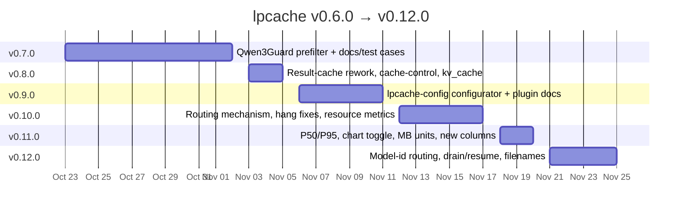
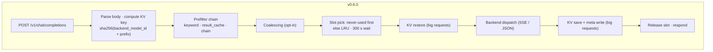
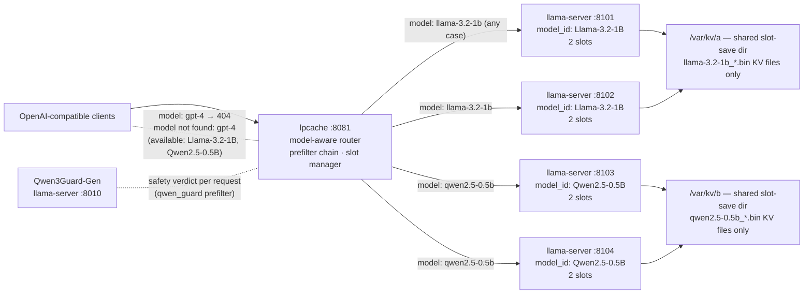
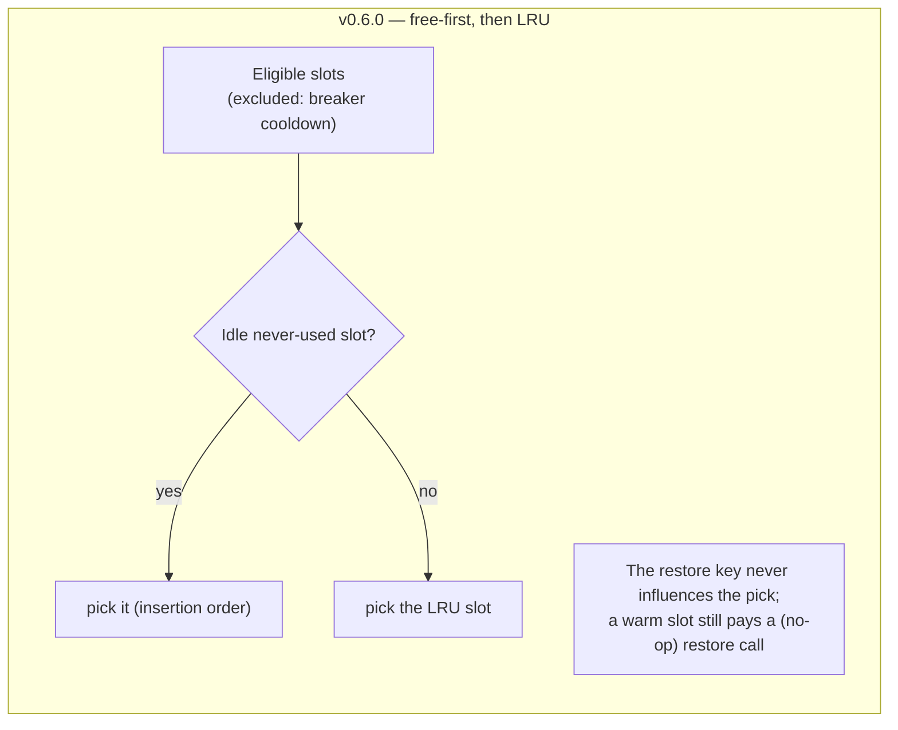
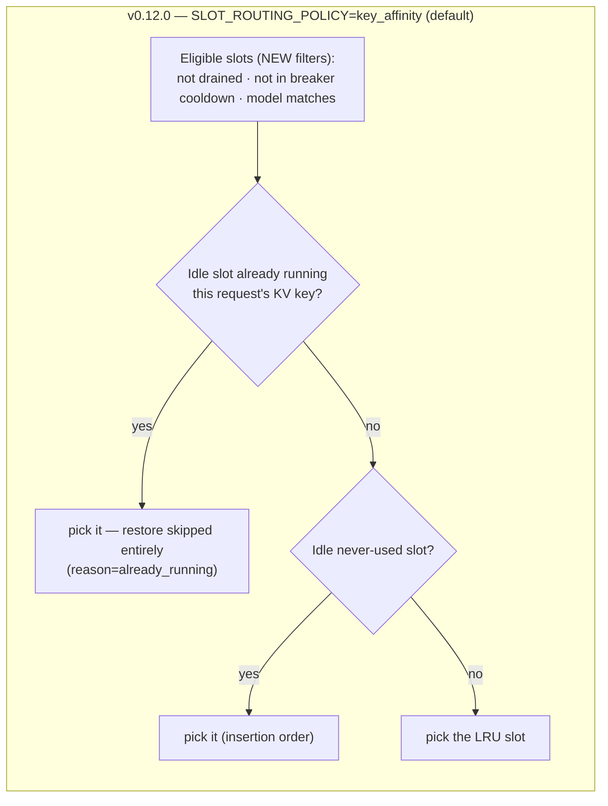
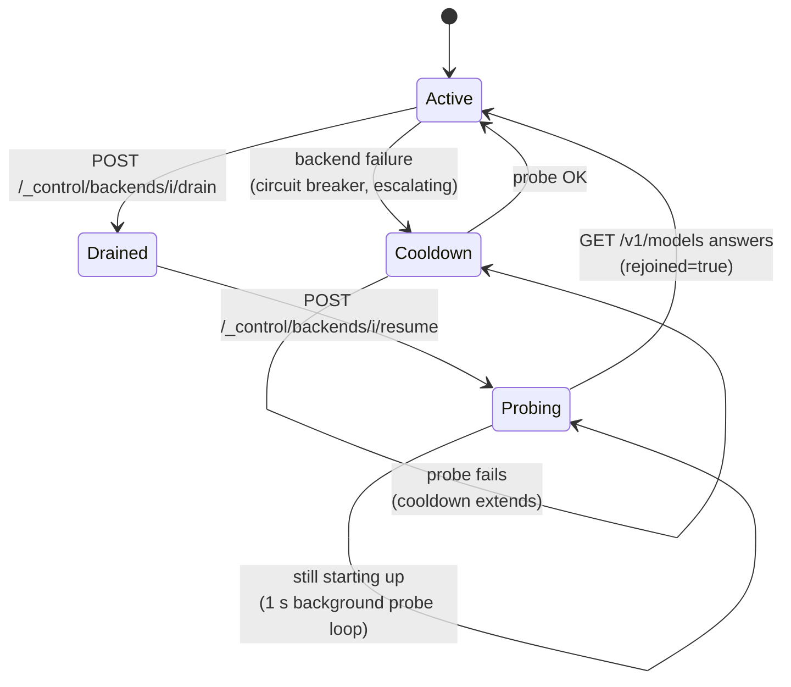
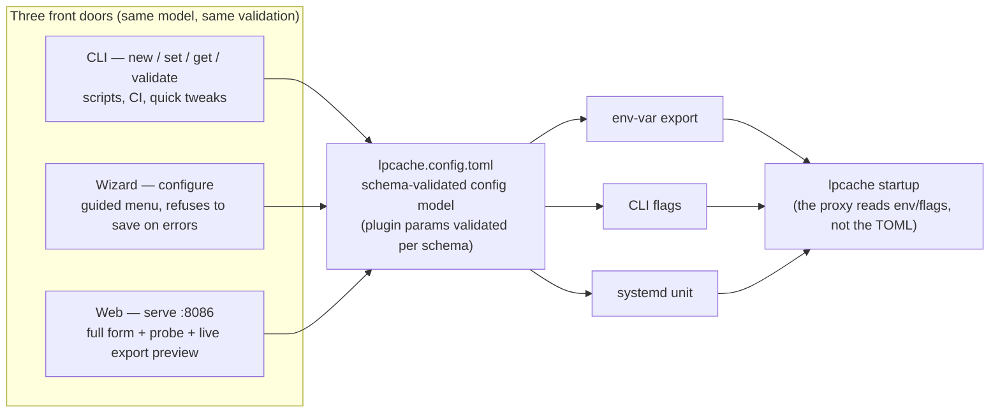

# From Single-Model Proxy to Multi-Model Fleet Manager

**A feature and design comparison: `lpcache` v0.6.0 → v0.12.0**

*Scope: tag `v0.6.0` (2026-10-22) → `HEAD` (`v0.12.0-1-g`, 2026-11-25). 25 commits, 75 files, +20,501 / −2,272 lines.*

---

## TL;DR

v0.6.0 was a **single-model, KV-cache-aware proxy**: one advertised model id, N
llama.cpp backends assumed to serve the same model, slot picking by
free-first/LRU, an optional result-cache prefilter, and a basic statistics
dashboard.

v0.12.0 is a **multi-model fleet manager**: per-backend `model_id` routing with
hard intake filtering, a key-affinity slot policy that turns restores into
no-ops, a drain/resume backend lifecycle API, per-backend KV opt-out,
content-safety and payload-capture plugins, per-request CPU/disk observability
with P50/P95 charts, and a full configuration tool suite (CLI + wizard + web
UI) in a new `lpcache-config` crate.

The core pipeline — parse → cache-key → prefilter → coalesce → slot acquire →
KV restore → backend dispatch → KV save → slot release — is unchanged; every
new capability slots into it as an opt-in stage, flag, or plugin.

---

## Release timeline

| Release | Date | Headline |
|---|---|---|
| v0.7.0 | 2026-11-02 | Qwen3Guard prefilter plugin + docs |
| v0.8.0 | 2026-11-05 | Result-cache rework, `cache_control`, per-backend `kv_cache` |
| v0.9.0 | 2026-11-11 | `lpcache-config` configurator, plugin documentation |
| v0.10.0 | 2026-11-17 | New routing mechanism, live-hang fixes, CPU/disk/memory metrics |
| v0.11.0 | 2026-11-20 | P50/P95, chart toggle, MB units, restore-candidate columns |
| v0.12.0 | 2026-11-25 | Model-id routing, drain/resume, filename convention, restore/save durations |



## The request pipeline: v0.6.0 vs v0.12.0

The spine is the same in both versions; v0.12.0 inserts new stages (marked
**NEW**) and tightens existing ones.

```mermaid
flowchart TB
    subgraph V12["v0.12.0"]
        B0["POST /v1/chat/completions"] --> B0b["payload_log: raw payload + headers dump<br/>(NEW, opt-in, before parsing)"]
        B0b --> B1["Parse body · compute KV key<br/>sha256(model + prefix)"]
        B1 --> B1b["Model filter (NEW): request model must match a<br/>configured backend id, else 404 model not found"]
        B1b --> B2["Prefilter chain<br/>keyword · qwen_guard (NEW) · result_cache<br/>(+ Cache-Control bypass, streaming cache)"]
        B2 --> B3["Coalescing (opt-in; lost-wakeup hang fixed)"]
        B3 --> B4["Slot pick (NEW key_affinity default):<br/>1 idle slot already running the KV key<br/>2 never-used · 3 LRU<br/>eligibility: not drained · not in cooldown · model matches"]
        B4 --> B4b["Restore skipped when the slot already runs<br/>the key (NEW, reason=already_running)"]
        B4b --> B5["KV restore (big requests;<br/>kv_cache-enabled backends only)"]
        B5 --> B6["Backend dispatch (SSE / JSON)"]
        B6 --> B7["KV save (skipped on self-restore,<br/>default) + meta write"]
        B7 --> B8["Release slot · respond<br/>request log 36 fields · dashboard<br/>(CPU/disk/ram, P50/P95, restore durations)"]
    end
```





## 1. The headline feature: model-aware routing (multi-model support)

**v0.6.0.** A single `MODEL_ID` env var was advertised by `GET /v1/models` and
used as the default; the cache key was
`sha256(backend_model_id + "\n" + raw_prefix)`. Every backend was assumed to
serve the one model, and a shared `--slot-save-path` directory mixed all
caches together.

**v0.12.0** (commit `14ffc52`). A `BACKENDS` entry can now carry a `model_id`,
and the field is **all-or-nothing**: set on every backend or on none — a mixed
set is a startup error that names the offending backends. When it is set on
every backend:

- **Intake filtering** — the request's `model` must match one of the configured
  ids (case-insensitive) or the request is rejected with
  `404 model not found: <model> (available: <ids>)`. This check runs at request
  intake in `app.rs`, *before* body-parsing side effects, prefilter plugins,
  coalescing, and slot acquisition — a deterministic check on static config.
- **Backend filtering** — requests only run on matching backends; the model id
  is threaded into slot selection as `SlotManager::acquire(restore_key, kv_model)`.
- **Model advertisement** — `GET /v1/models` lists the configured ids instead
  of the single `MODEL_ID`.
- **Model-scoped cache keys** — the cache key becomes
  `sha256(model + "\n" + raw_prefix)`, where *model* is the id the cache is
  addressed by (the first backend's reported id by default, or the request's
  lowercased `model` under model-aware routing).
- **Unified filename convention** — KV cache and result-cache files are named
  `{lowercase(model_id)}_{key}` (new `hashing::kv_basename`). Different models'
  caches never collide in a shared `--slot-save-path` directory, which is what
  lets two model pools safely share per-model save directories.

The v0.12.0 fleet shape, as exercised in this repository's live 4-backend
CPU validation:



**KV directory layout, before vs after.**

```text
v0.6.0 — unprefixed names; a shared --slot-save-path mixes models:
  /var/kv/
  ├── a1b2c3d4e5f60718293a4b5c6d7e8f90
  ├── f9e8d7c6b5a4938271605f4e3d2c1b0a
  └── ...
  ./kv_meta/
  ├── a1b2c3d4e5f60718293a4b5c6d7e8f90.meta.json   (which model? only the meta knows)
  └── ...

v0.12.0 — model-prefixed names; per-model dirs in the fleet example:
  /var/kv/a/
  ├── llama-3.2-1b_a1b2c3d4e5f60718293a4b5c6d7e8f90
  ├── llama-3.2-1b_f9e8d7c6b5a4938271605f4e3d2c1b0a
  └── ...
  /var/kv/b/
  ├── qwen2.5-0.5b_0a1b2c3d4e5f60718293a4b5c6d7e8f90
  ├── qwen2.5-0.5b_9f8e7d6c5b4a32100f1e2d3c4b5a6978
  └── ...
  ./kv_meta/                                   (meta files: same key names)
```

The lowercasing matches the model id used in the cache-key hash, so a key is
always addressed by the same filename it was saved under.

Without `model_id`s the default behavior is unchanged.

**Live validation.** The current code was exercised with 4 CPU-only
Llama-3.2-1B backends (2 per model, per-model shared KV dirs), 5,000 requests
at 11-way concurrency with intermittent backend draining: **zero cross-model
dispatches** across 4,861 dispatches (e.g. be0→a 1,504 · be1→a 857 ·
be2→b 1,214 · be3→b 1,286), unknown model → `404`, uppercase model id → `200`,
and both KV directories stayed model-clean (only their own model's files). The
filter held even while one of the model-a backends was crashing live.

## 2. Slot routing: a new policy and two live-hang fixes

**v0.6.0.** The proxy picked a never-used slot first, otherwise the least
recently used one. The restore key never influenced the pick.

**v0.12.0** (commits `4648b7a`, `2181341`).

- **`SLOT_ROUTING_POLICY`** — new env var with two values:
  - `key_affinity` (**new default**): before the free/LRU tiers, prefer an
    idle slot *already running* the request's KV cache key, so the restore
    becomes a no-op. This is the biggest single-request latency win of the
    range: repeated prompts (the exact pattern KV caching targets) hit a warm
    slot and skip the restore round-trip entirely.
  - `lru`: the original free-first-then-LRU policy, preserved verbatim.
- **Already-running restore skip** — the proxy now tracks the last key each
  slot loaded (via a successful restore or save). When the picked slot already
  runs the candidate key, the restore call is skipped entirely and logged as
  `restore_skipped ... reason=already_running` — llama.cpp keeps a slot's KV
  across requests, so the call would have been wasted work.
- **Two live hangs fixed** (`2181341`):
  1. *Mark slots used* — slots that were being picked repeatedly while busy
     are now correctly marked used, eliminating a live hang.
  2. *Coalescing lost-wakeup* — a follower's check-then-wait pattern could lose
     a `Notify` wakeup if `finish()` landed between an un-polled `notified()`
     and its first poll; the interest is now registered (`enable()`) **before**
     the condition check, with a no-sleep regression test
     (`early_finish_does_not_lose_the_wakeup`) that pins both interleavings.

The pick logic, before vs after:





(`SLOT_ROUTING_POLICY=lru` restores the top diagram's tiers with the new
eligibility filters.)

The dashboard's slot grid is now grouped by backend, matching the
per-backend view of the fleet.

## 3. Backend lifecycle: drain/resume API

New in `14ffc52`. Two control endpoints:

```
POST /_control/backends/{index}/drain
POST /_control/backends/{index}/resume
```

(404 on an out-of-range index; like the dashboard routes they are excluded from
the request log.)

Design semantics, as implemented in `slot_manager.rs`:

- `drain(be)` excludes the backend from slot selection in **all** pick tiers —
  `eligible()` unconditionally filters drained backends — but **never touches
  in-flight requests**: "drain only affects the pick, never a held slot."
- `resume(be)` clears the flag and health-probes the backend before it
  re-joins the pool (an unhealthy probe keeps the backend parked until the
  1 s background probe loop recovers it).
- Documented fail-fast: if *every* backend serving a model is ineligible
  (drained or in circuit-breaker cooldown), chat requests fail immediately
  with `503 all slots busy, please retry later` instead of queueing behind an
  empty pool.

**Backend lifecycle state machine** (drain on top of the v0.6.0 circuit
breaker):



Note the asymmetry: **drain** is operator-controlled and unconditional — it
removes the backend from *all* pick tiers, even the all-down fail-open path —
while **cooldown** is failure-driven. A drained backend never receives a new
request; its in-flight slots run to completion untouched.

**Sample exchange** (backend indices from the `BACKENDS` array):

```bash
$ curl -s -X POST http://localhost:8081/_control/backends/1/drain
{"index":1,"drained":true,"down":false,"cooldown_secs":0,"failure_streak":0}

$ curl -s -X POST http://localhost:8081/_control/backends/1/resume
{"index":1,"drained":false,"down":false,"cooldown_secs":0,"failure_streak":0,"rejoined":true}

$ curl -s -X POST http://localhost:8081/_control/backends/99/drain
{"error":"backend index out of range"}            # HTTP 404
```

Typical runbook for restarting one `llama-server` in the pool (faster and
cleaner than letting the breaker notice the dead backend):

```sh
curl -X POST http://localhost:8081/_control/backends/1/drain   # 1. out of rotation
# 2. restart that llama-server
curl -X POST http://localhost:8081/_control/backends/1/resume  # 3. re-join (waits for /v1/models)
```

With the dashboard enabled, the same operations appear as buttons per backend
row (a drained row shows a `DRAINED` badge).

**Live validation.** The same 4-backend test drove a 10 s-interval / 5 s-drain
loop over all backends (~80 cycles across the runs). Pick-time violation check
against the logged drain windows showed **zero** true violations; every 503 in
the runs correlated 1:1 with a window in which *both* backends of a model were
simultaneously out of the pool (the other one in breaker cooldown after a
backend crash) — exactly the documented fail-fast, never a misroute.

## 4. Per-backend KV cache opt-out

`BACKENDS` entries gained `"kv_cache": true` (default). Set it to `false` for
backends without slot save/restore support (e.g. llama-server < 1.05.40):

- restores are only ever issued to slots of `kv_cache`-enabled backends
  (logged as `kv_restore_skipped reason=no_kv_enabled_backend`);
- a request served by a disabled backend neither saves its KV cache nor writes
  a meta file.

This lets a mixed-version fleet run behind one proxy without the proxy issuing
calls a backend can't honor.

## 5. KV cache mechanism refinements

- **`SKIP_SAVE_ON_SELF_RESTORE` (default `true`)** — after a request that just
  successfully restored *its own* key, the post-request save is skipped: a
  cold restore's 200 already proved the KV file's presence. A warm
  "already-running" no-op restore skips only while the key's meta file is still
  on disk; a missing meta file makes the save re-write the pair, **healing**
  it. A ratio-1.0 *prefix* match (a multi-turn extension) is not a
  self-restore and still saves. Net effect: fewer redundant disk writes under
  the repeated-prompt workloads the cache targets.
- **Startup meta cleanup** — at startup, corrupt `.meta.json` files in
  `META_DIR` are removed; with `STARTUP_CLEANUP_KV=true` the orphan KV files of
  the removed metas are deleted as well. (Added alongside model-aware routing,
  since KV filenames now carry the model prefix.)
- **Model-aware pruning** — the LRU pruner now returns `(key, model_id)` for
  each removed meta so it deletes the correctly prefixed
  `{model}_{key}` KV files from the backend's `slot_save_path` directories.

## 6. Result-cache prefilter upgrades (commits `647facd`, `4259b36`)

- **`cache_control` param** — when `true`, a request whose `Cache-Control`
  header carries the `no-cache` directive is forwarded to the backend instead
  of being answered from the cache. Standard HTTP cache semantics for operators
  who want per-request bypass without disabling the plugin.
- **`cache_streaming` param** — when `true`, completed *streaming* results are
  aggregated into a non-streaming completion and cached, and cached entries are
  served to streaming clients as SSE. (By default streaming is never cached.)
- **Mechanism adjustment** (`647facd`) — internal rework of how cached entries
  are matched/stored, and entry filenames moved to the unified
  `{lowercase(model_id)}_{key}.json` convention from §1.

## 7. Two new built-in plugins (plugin set: 6 → 8)

**`qwen_guard`** — a content-safety prefilter backed by a
**Qwen3Guard-Gen** model (Alibaba's safety-moderation series built on Qwen3),
run as a *separate* llama-server (or any OpenAI-compatible endpoint). The
guard is a generative classifier: it answers with one of three severity levels
(`Safe`, `Controversial`, `Unsafe`) plus zero or more harm categories. The
plugin classifies the request's combined message text as a *prompt* (Qwen3Guard
prompt-moderation mode) and rejects with `400` when the verdict hits:

- `reject_levels` (default `["Unsafe"]`), or
- `reject_categories` (default none, independent of level).

Operational params: `url` (required), `api_key`, `model`, `timeout_secs`
(default 30), `max_input_chars` (guard models have small contexts), `on_error`
(default `accept` — a failed guard call doesn't block traffic) and
`on_unparseable`. ~1,240 lines including a full verdict parser and test cases
(`test-cases/12-qwen-guard-plugin.md`).

**`payload_log`** — dumps each chat request's raw payload to a unique file in
a configured directory (`REQUEST_PAYLOAD_DIR` env var) **as it arrives**:
before JSON parsing, prefiltering, or backend dispatch. Malformed bodies
(422) and prefilter-rejected requests are captured too. One payload file plus
a paired headers file per request:

```
{dir}/{seq:06}-{timestamp}-{key16}.json     (valid UTF-8 payloads)
{dir}/{seq:06}-{timestamp}-{key16}.bin      (anything else)
{dir}/{seq:06}-{timestamp}-{key16}.headers  (the request's HTTP headers)
```

Useful for post-mortem debugging of client-reported issues — the exact bytes
that hit the wire, with headers.

## 8. Observability: dashboard and request log

The dashboard plugin grew by ~3,000 lines across five commits:

- **Resource metrics** — a new `src/procsample.rs` module (626 lines) samples
  the proxy process's own CPU (`CLOCK_PROCESS_CPUTIME_ID` on Unix,
  `GetProcessTimes` on Windows) and actual storage I/O (Linux
  `/proc/self/io` `read_bytes`/`write_bytes`; macOS `rusage_info`). One sample
  is taken when a request arrives and delta'd when the response completes, so
  CPU and disk I/O are **per-request** fields — the backend is a separate
  process and is deliberately never counted.
- **P50/P95 statistics** for throughput and resources (commit `7e14e40`).
- **KV restore/save duration statistics** per request, surfaced on the
  dashboard and in the request log (commit `bb242da`).
- **UX**: bar/line chart toggle; byte metrics rendered in MB for readable
  charts; a backend filter; the slot grid grouped by backend; the Recent
  Request list's Backend column widened to *Backend / slot*; and new
  *restore candidate key* + *matching ratio* columns so operators can see
  *why* a restore happened (or was skipped) at a glance.

The **request log** grew from 28 to **36** XLF fields — the new
`lpcache-*` pipeline/performance/resource fields include the per-request CPU,
disk I/O, and KV restore/save durations above.

## 9. New crate: the `lpcache-config` configurator (~5,200 lines)

Commit `578031c` (+ web-editor fix `c782c0f`) adds a third workspace member:

- **Three front doors** to the same validated model: one-shot CLI commands,
  an interactive wizard (`configure`), and a web UI (`serve`).
- **Schema-driven plugin editor** — `plugin_schema.rs` (1,111 lines) describes
  every built-in plugin's parameters with validation, so the UI/wizard can
  offer per-plugin editing and surface errors before export.
- **Probe + export** — the web flow can probe configured backends, then export
  the whole configuration as env assignments or a launcher script
  (`exporters.rs`).
- Modules: `model.rs` (1,176), `plugin_schema.rs` (1,111), `wizard.rs`
  (1,014), `ui.html` (790), `exporters.rs` (342), `web.rs` (241), with
  `docs/configurator-guide.md` and 17 screenshots documenting the flow.



Sample session:

```bash
lpcache-config new lpcache.config.toml      # fresh file with built-in defaults
lpcache-config set proxy.port 8090          # change one value (creates file too)
lpcache-config set plugins.json '[{"name":"qwen_guard","params":{"url":"http://guard:8080"}}]'
lpcache-config get plugins.json
lpcache-config validate                     # exit 1 on errors; warnings listed separately
lpcache-config configure                    # interactive wizard (alias: wizard)
lpcache-config serve --port 9000 -c /etc/lpcache/config.toml   # web UI
# then export env vars / a launcher script / a systemd unit and start lpcache
```

Note the deliberate boundary: `lpcache` itself never reads the TOML file —
the configurator *converts* it to env vars/flags/unit at deploy time. Two
proxy parameters (`SKIP_SAVE_ON_SELF_RESTORE`, `STARTUP_CLEANUP_KV`) are
env/flag-only by design.

This is a design-level addition: the configuration surface had grown (model
ids, routing policy, KV opt-out, payload log, guard params) to the point where
hand-writing `BACKENDS`/`PLUGINS` JSON was error-prone; the configurator makes
the schema the source of truth for both the proxy and the tooling.

## 10. Testing and documentation

- **`tests/api.rs` +5,002 lines**; current suites: **123** `lpcache` unit
  tests, **114** plugin-library unit tests, **29** configurator unit tests, and
  **92** integration tests — plus a functional & load-testing section in the
  README (mock backends, no real model required).
- **New documentation**: `PLUGINS.md` (701 lines — full plugin behavior, edge
  cases, worked examples, and a live Llama-3.2-1B run),
  `docs/configurator-guide.md`, `test-cases/12-qwen-guard-plugin.md`,
  `PARAMETERS.md` (+359 lines), five dashboard screenshot sections, and a
  rewritten setup guide.

## 11. What stayed the same

The core pipeline order, the hashing scheme (word blocks of
`WORDS_PER_BLOCK`, per-block SHA256), big/small classification
(`BIG_THRESHOLD_WORDS`), LCP-based restore candidacy (`LCP_TH`), meta LRU
pruning (`META_MAX`), byte-for-byte SSE passthrough, coalescing of concurrent
same-key requests, and the per-backend circuit breaker (escalating cooldown +
background probe loop) all existed in v0.6.0 and are unchanged in spirit.
Every v0.6.0 env var still works; the legacy `PREFILTER_*` → plugin synthesis
is preserved; model-aware routing and the new plugins are strictly opt-in.

## 12. Migration notes for operators

| Change | Action |
|---|---|
| Multi-model serving | Add `model_id` to **every** `BACKENDS` entry (or none) — mixed sets fail at startup by design |
| New default slot policy | Set `SLOT_ROUTING_POLICY=lru` to restore v0.6.0 pick behavior |
| Older llama-server backends | Set `"kv_cache": false` on entries for servers < 1.05.40 |
| Result cache | `cache_control` / `cache_streaming` are opt-in params; entry filenames now carry the model prefix |
| Disk writes | `SKIP_SAVE_ON_SELF_RESTORE=true` (default) reduces redundant saves; `STARTUP_CLEANUP_KV=true` reclaims orphans |
| Config authoring | `lpcache-config` can now build/validate/export the whole config instead of hand-written JSON |

---

## Appendix A — Configuration: v0.6.0 vs v0.12.0

**v0.6.0 — single model, legacy prefilter variables:**

```bash
LLAMA_URL=http://127.0.0.1:8000 N_SLOTS=2 \
MODEL_ID=llama-3.2-1b \
META_DIR=/var/kv_meta SLOT_SAVE_PATH=/var/kv META_MAX=10 \
COALESCE_REQUESTS=true \
PREFILTER_BLOCKLIST='confidential,internal' \
PREFILTER_RESULT_CACHE_DIR=/var/results PREFILTER_RESULT_CACHE_TTL=300 \
REQUEST_LOG=true REQUEST_LOG_PATH=/var/log/lpcache/req.log \
./target/release/lpcache
```

**v0.12.0 — multi-model fleet with every new feature enabled** (the same
4-backend topology as the fleet diagram; note `kv_cache:false` on backend 3
as a mixed-version opt-out, and that `PLUGINS` now replaces the legacy
`PREFILTER_*`/`REQUEST_LOG*` variables entirely):

```bash
BACKENDS='[
  {"url":"http://127.0.0.1:8101","n_slots":2,"slot_save_path":"/var/kv/a","model_id":"Llama-3.2-1B"},
  {"url":"http://127.0.0.1:8102","n_slots":2,"slot_save_path":"/var/kv/a","model_id":"Llama-3.2-1B"},
  {"url":"http://127.0.0.1:8103","n_slots":2,"slot_save_path":"/var/kv/b","model_id":"Qwen2.5-0.5B"},
  {"url":"http://127.0.0.1:8104","n_slots":2,"slot_save_path":"/var/kv/b","model_id":"Qwen2.5-0.5B","kv_cache":false}
]' \
SLOT_ROUTING_POLICY=key_affinity \
SKIP_SAVE_ON_SELF_RESTORE=true \
STARTUP_CLEANUP_KV=true \
META_DIR=/var/kv_meta META_MAX=10 \
COALESCE_REQUESTS=true \
PLUGINS='[
  {"name":"keyword","params":{"keywords":"confidential, internal","case_insensitive":true}},
  {"name":"qwen_guard","params":{"url":"http://127.0.0.1:8010","reject_levels":["Unsafe"],"timeout_secs":10,"cache_max":256}},
  {"name":"result_cache","params":{"dir":"/var/results","ttl_secs":600,"cache_control":true,"cache_streaming":false}},
  {"name":"request_log","params":{"path":"/var/log/lpcache/req.log","max_bytes":10485760,"keep":5}},
  {"name":"payload_log","params":{"dir":"/var/log/lpcache/payloads"}},
  {"name":"dashboard","params":{"path":"/dashboard","refresh_ms":2000}}
]' \
./target/release/lpcache
```

Expected startup log (abridged):

```text
client_init url=http://127.0.0.1:8101 api_key=false
client_init url=http://127.0.0.1:8102 api_key=false
client_init url=http://127.0.0.1:8103 api_key=false
client_init url=http://127.0.0.1:8104 api_key=false
slot_manager n_backends=4 total_slots=8
model_routing_enabled models=["Llama-3.2-1B", "Qwen2.5-0.5B"]
app_start version=0.12.0 n_backends=4 port=8081 meta_max=10 stream_queue=16
listening on 0.0.0.0:8081
```

## Appendix B — End-to-end walkthrough (model-aware routing)

```bash
# 1. What does this proxy serve? — the configured ids, not MODEL_ID
curl -s localhost:8081/v1/models
# {"data":[{"id":"Llama-3.2-1B","object":"model"},
#          {"id":"Qwen2.5-0.5B","object":"model"}]}

# 2. Normal request → 200, served by a model-matching backend only
curl -s -o /dev/null -w '%{http_code}\n' localhost:8081/v1/chat/completions \
  -H 'content-type: application/json' \
  -d '{"model":"Llama-3.2-1B","messages":[{"role":"user","content":"hi"}]}'
# 200

# 3. Matching is case-insensitive (cache key uses the lowercased id)
#    "llama-3.2-1b" → 200   "LLAMA-3.2-1B" → 200

# 4. Unknown model → 404 at intake — no slot, no KV work, no backend call
curl -s -w '\n%{http_code}\n' localhost:8081/v1/chat/completions \
  -H 'content-type: application/json' \
  -d '{"model":"gpt-4","messages":[{"role":"user","content":"hi"}]}'
# {"error":"model not found: gpt-4 (available: Llama-3.2-1B, Qwen2.5-0.5B)"}
# 404

# 5. Cross-model isolation (verified over 5,000 live requests):
#    llama-3.2-1b traffic lands only on backends 0–1, qwen2.5-0.5b only on 2–3
# 6. Result-cache bypass (cache_control=true):
curl -s -H 'Cache-Control: no-cache' localhost:8081/v1/chat/completions ...
#    → forwarded to the backend even though a fresh entry exists
```

---

## Appendix C — Observability samples

**Request log (W3C XLF) — 36 fields.** The last five (resource) fields and
the restore-candidate fields are new in this range; `lpcache-restore-call`
takes the values `ok`, `skipped` (the slot already ran the key — no backend
call), `rejected`, `failed`, or `-` (small request / no candidate):

```text
#Software: lpcache-plugins/0.1.0
#Version: 1.0
#Date-format: %Y-%m-%dT%H:%M:%S.%fZ
#Fields: datetime cs-method cs-uri c-ip cs(User-Agent) cs-bytes cs-time sc-status sc-bytes lpcache-model lpcache-stream lpcache-key lpcache-n-words lpcache-is-big lpcache-backend lpcache-slot lpcache-restored lpcache-restore-call lpcache-restore-candidate lpcache-lcp-ratio lpcache-cache-hit lpcache-coalesced lpcache-reason lpcache-prompt-tokens lpcache-completion-tokens lpcache-cached-tokens lpcache-prefill-ms lpcache-gen-ms lpcache-prefill-tps lpcache-gen-tps lpcache-ttft-ms lpcache-cpu-ms lpcache-disk-read-bytes lpcache-disk-write-bytes lpcache-ram-bytes lpcache-peak-ram-bytes
2026-11-25T03:14:21.687Z POST /v1/chat/completions - "python-requests/2.32.3" 482 1247 200 1834 llama-3.2-1b false 2466479e1ab0c3d5 1840 true 0 0 true skipped 2466479e1ab0c3d5 1.000 false false - 1512 214 1498 183.2 96.4 8253.2 2220.1 - 3.1 4096 524288 198343168 198343168
```

Reading the record: a **big** 1,840-word request on backend 0 / slot 0 whose
restore was **skipped** because that slot already ran key
`2466479e1ab0c3d5` (the key-affinity pick doing its job) — the backend
nonetheless reported 1,498 cached tokens, prefill ran in 183 ms, and the
*proxy process itself* spent 3.1 ms CPU and wrote 512 KiB of disk I/O during
the request, with 189 MiB RAM at completion.

**Payload log** — files appear in `REQUEST_PAYLOAD_DIR` as the request
arrives, before parsing (so a malformed body is captured as `.bin` with
`nokey`):

```text
/var/log/lpcache/payloads/
├── 000042-2026-11-25T03-14-21.682Z-2466479e1ab0c3d5.json      # raw payload
├── 000042-2026-11-25T03-14-21.682Z-2466479e1ab0c3d5.headers   # one "name: value" per header
├── 000043-2026-11-25T03-14-22.114Z-9f8e7d6c5b4a3210.bin        # non-UTF-8 / unparseable
└── 000043-2026-11-25T03-14-22.114Z-9f8e7d6c5b4a3210.headers
```

**Dashboard** (`/dashboard`, screenshots in `docs/screenshots/`) — the new
panels per tab:

| Tab | New in this range |
|---|---|
| General | throughput with P50/P95, bar/line chart toggle, bytes shown in MB, backend filter |
| Backends | per-backend rows with Drain/Resume buttons, `DRAINED` badge, breaker state |
| Slots | slot grid grouped by backend; Backend / slot shown per request |
| Recent requests | restore candidate key + LCP matching ratio, KV restore/save durations, cache-hit flag |
| Resources | proxy-process CPU, disk read/write, RAM + peak RAM, P50/P95 |

---

## Conclusion

The v0.6.0 → v0.12.0 arc is a shift from *a clever proxy for one model* to *a
fleet manager for many*: model-aware routing with hard intake filtering and
collision-proof cache naming, slot picks that exploit warm KV state, a
first-class backend lifecycle (drain/resume) that operators can drive from
scripts, honest per-request resource accounting, and tooling (configurator)
that keeps the growing configuration surface trustworthy. The pipeline's
shape never changed — the new capabilities are stages, flags, and plugins
plugged into the same parse → key → prefilter → coalesce → acquire →
restore → dispatch → save → release spine that v0.6.0 introduced.

*Key commits: `4a75cc8`/`8ed28a2` (qwen guard) · `647facd`/`4259b36` (result
cache) · `578031c` (configurator) · `9ac4b0b`/`31a38b9` (resource/memory
metrics) · `4648b7a` (routing mechanism) · `2181341` (hang fixes) · `7e14e40`
(P50/P95) · `bb242da` (restore/save durations) · `14ffc52` (model-id routing,
drain/resume, filename convention).*


