# Configuring lpcache with `lpcache-config`

`lpcache-config` is the configurator bundled with this repository
(package `lpcache-config`, crate `configurator/`). It edits, validates and
exports the lpcache configuration in three interchangeable styles:

| Style | Command | Best for |
| --- | --- | --- |
| One-shot CLI | `set` / `get` / `validate` … | scripts, CI, quick tweaks |
| Guided menu (TUI) | `configure` | first-time setup, hand-editing a full config |
| Web UI | `serve` | browsing every field with a live export preview |

All three write the **same TOML file** (default `lpcache.config.toml` in the
current directory) and run the **same validation**, so a value accepted in
one style is accepted everywhere. Note that `lpcache` itself never reads
the TOML file — the configurator converts it to environment variables /
CLI flags / a systemd unit when you deploy.

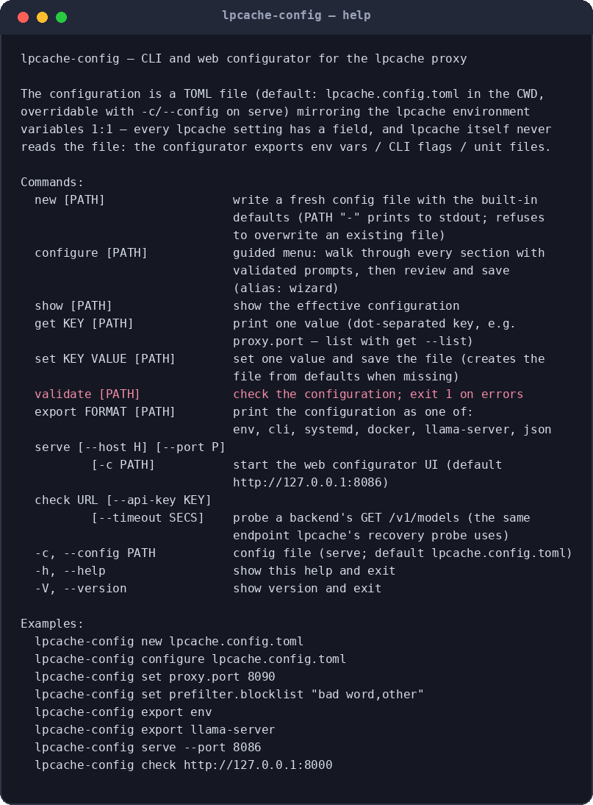

## Build

```bash
cargo build --release -p lpcache-config
# binary: target/release/lpcache-config
```

## Five-minute quickstart

```bash
lpcache-config new lpcache.config.toml     # fresh file with built-in defaults
lpcache-config set proxy.port 8090         # change one value (also creates the file)
lpcache-config validate                    # exit code 1 on errors
```

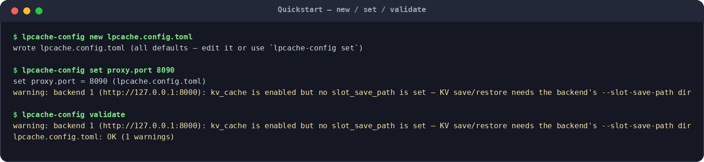

`validate` prints errors and warnings separately — the warning above is the
common "kv_cache on but no slot_save_path" case, which is harmless for
backends whose llama-server cannot save/restore KV caches.

Then export whatever your deployment needs (see
[Exports](#exporting-the-configuration)) and start `lpcache` with it.

## The guided menu — `configure`

```bash
lpcache-config configure            # or `configure PATH`, alias: `wizard`
```

You land on a section menu that summarises the current values, so you can
jump straight to the part you care about:

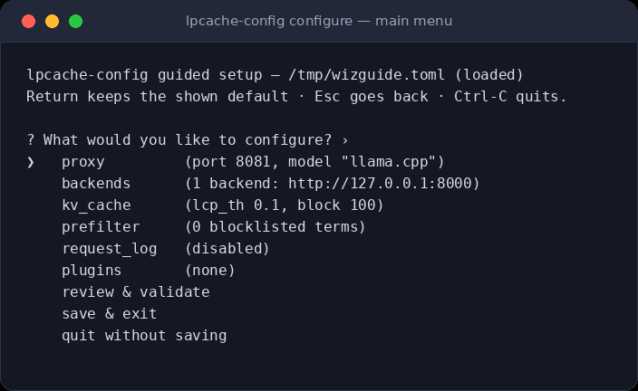

Keys: **↑/↓** move, **Return** selects, **Esc** goes back one level,
**Ctrl-C** aborts without writing anything.

Every field prompt shows the current value as its default — press
**Return** to keep it, or type a new one. Values are validated as you
type: a bad port or an unparsable float is refused with a one-line
message, and the prompt just asks again.

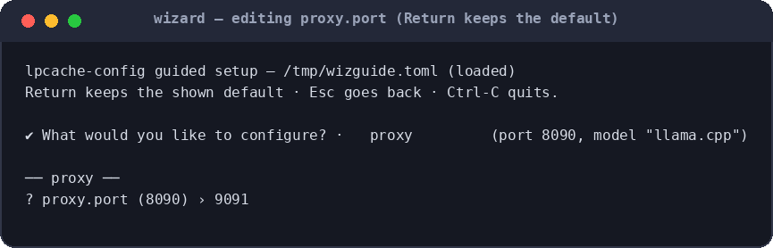

Sections you changed get a `*` marker in the menu, with the live summary
updated (port now `9091`):

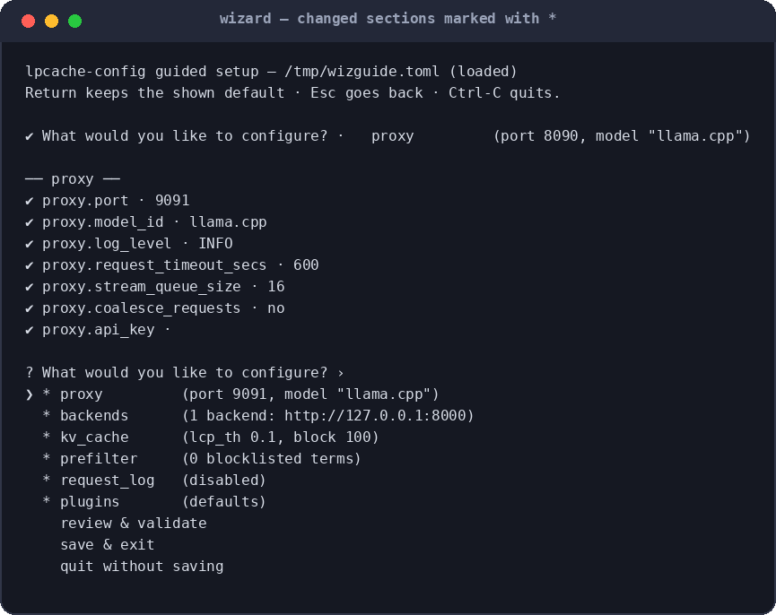

### Backends

The **backends** submenu is a small CRUD list: edit any entry, add new
ones, remove one, or done. Per backend you set the URL, `n_slots` (must
match the llama-server's `-np/--parallel`), `slot_save_path` (must match
its `--slot-save-path`), and a `kv` yes/no for KV save/restore support
(llama-server ≥ 1.05.40).

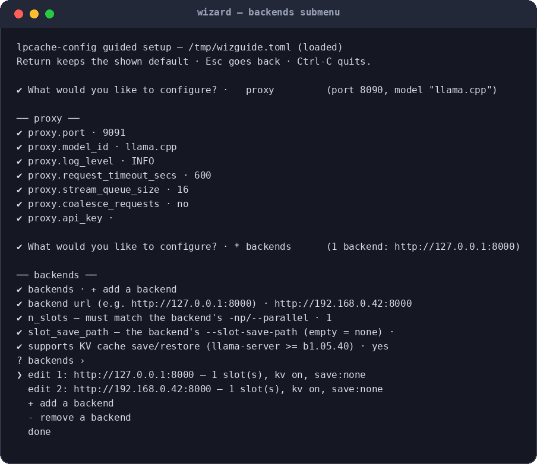

### Plugins

The **plugins** submenu edits the `PLUGINS` array (the `[plugins]` section in
the TOML file). The root menu line summarises its state —
`plugins (none)`, `plugins (3 plugin(s))`, or `plugins (INVALID JSON)`; a
list that does not parse is routed straight to a raw-JSON editor instead of
guessed at.

The submenu is a CRUD list of the current specs, each summarised on one line
(`keyword — 3 item(s)`, `qwen_guard — http://guard:8080`; names the schema
does not know are flagged `(unknown plugin)`):

- **edit** an entry — the built-ins walk you through **every param** of the
  plugin's schema (see
  [The PLUGINS section](#the-plugins-section--every-built-in-and-its-params)):
  the current value is shown as the default, **Return** keeps it, a value
  left at the plugin's own default is *omitted* from the JSON so `PLUGINS`
  stays compact, and params the schema does not know about are carried over
  untouched. Entries whose name the schema does not know (a custom registry
  plugin) fall back to a raw-JSON prompt so nothing is lost.
- **+ add a plugin** — pick one of the six selectable built-ins, then answer
  the same per-param prompts. `llama` is not offered: one backend client is
  created automatically per `[[backend]]`, and a `llama` spec in `PLUGINS`
  would be a no-op (the validator tells you so).
- **- remove a plugin**, or edit the whole list as raw JSON.

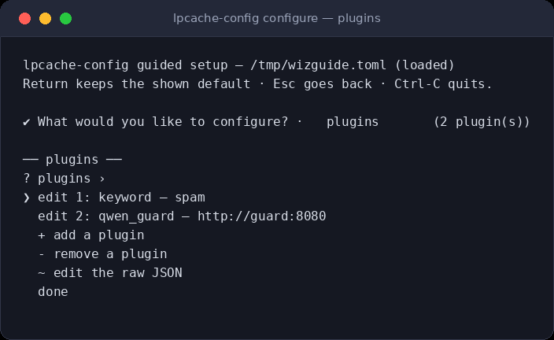

The `chain` plugin gets a nested list editor for its `filters` (prefilter
kinds only, arbitrarily deep), and `request_log` / `dashboard` are
singletons — a second spec of either is a validation error that blocks
**save & exit**.

### Review and save

**review & validate** echoes the complete effective configuration and
runs the same validator as `validate`. **save & exit** then prints any
warnings, asks for confirmation, and writes the file — but it refuses to
save while errors exist and bounces you back to the menu instead.

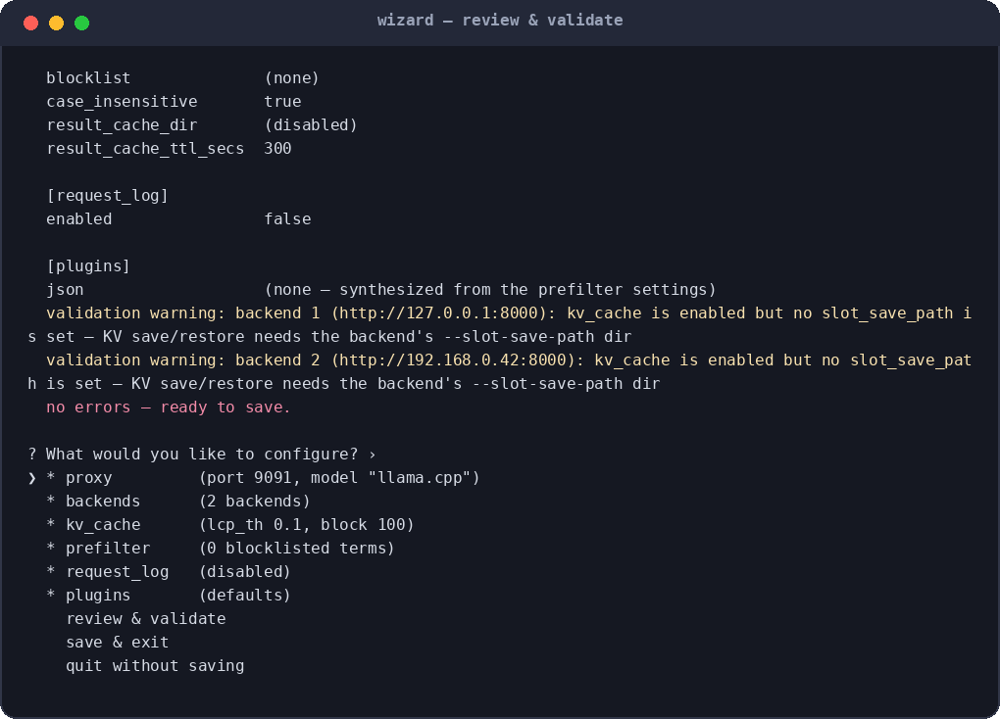
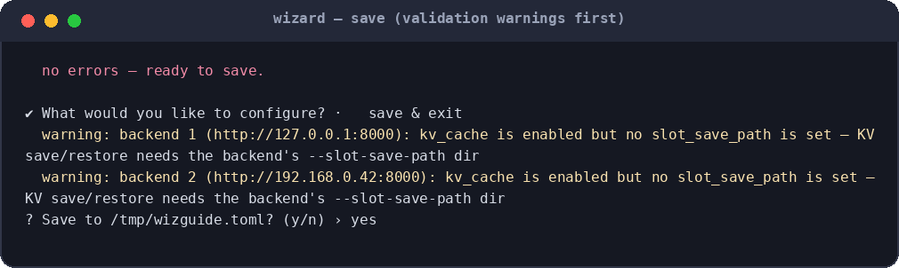
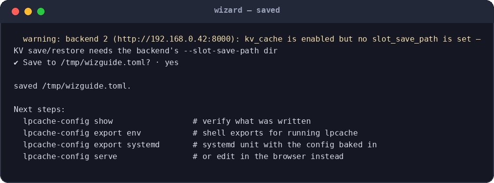
## The web configurator — `serve`

```bash
lpcache-config serve                     # http://127.0.0.1:8086
lpcache-config serve --port 9000 -c /etc/lpcache/config.toml
```

The page is a full form for every setting, a chip showing the file
status (`saved` / `modified` / `warnings` / `invalid`), a **Reload**
button to pick up on-disk edits, and a live export preview on the right:

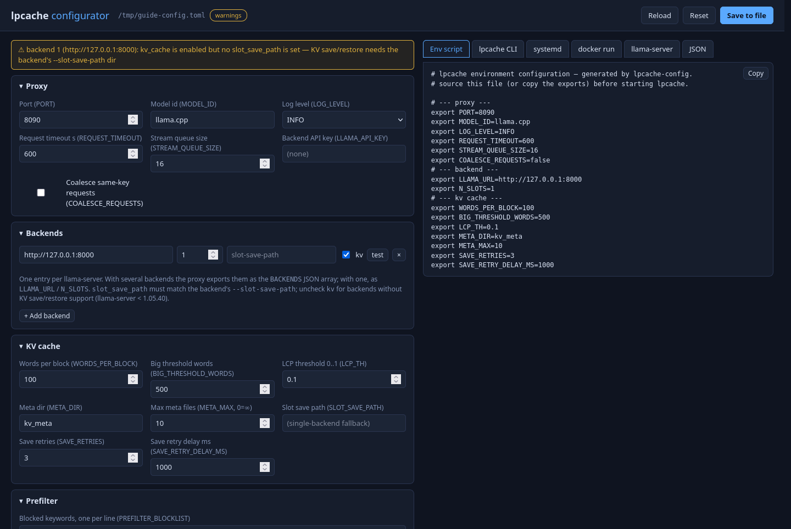

### Probe a backend

Each backend row has a **test** button that performs the same
`GET /v1/models` probe lpcache uses for recovery, so you can confirm the
URL and API key are right before deploying:

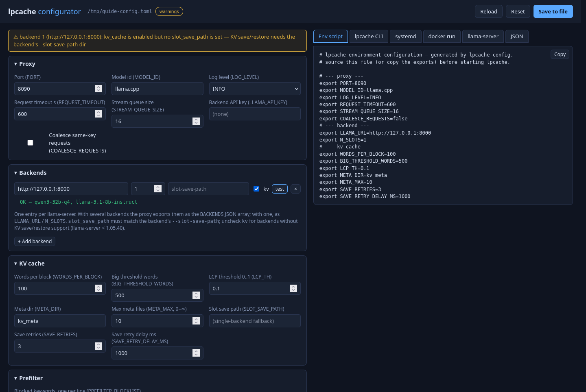

### The plugin chain editor

The **Plugins (PLUGINS)** panel is a schema-driven editor for the whole
chain: its forms are generated at load time from the *same param table* the
Rust validator uses (served by `GET /api/plugins`), so the UI cannot drift
from what `lpcache` accepts at startup:

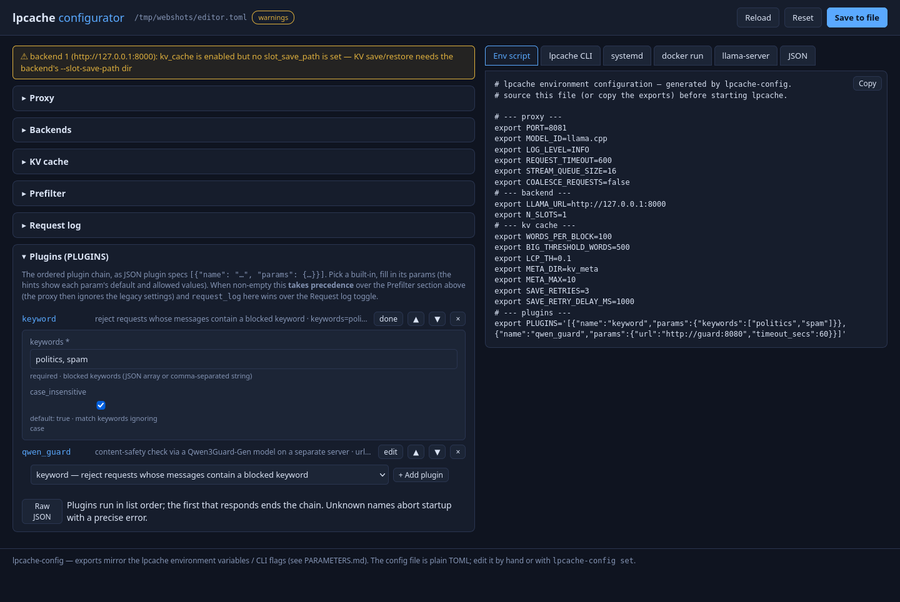

- **+ Add plugin** offers the six selectable built-ins; `request_log` and
  `dashboard` disappear from the picker once one is present (they are
  singletons), and nested lists (`chain.filters`) only offer prefilter kinds.
- **edit** expands an entry into a form with one control per param kind —
  text inputs (masked for `api_key`), number inputs with min/max, checkboxes,
  dropdowns for enums, comma-separated text for string lists, and a nested
  plugin list for `chain.filters`. Each field carries a hint line (required /
  default / allowed values / range), and values equal to the plugin default
  are dropped from the JSON on the way out.
- **▲ / ▼** reorder the chain, **×** removes an entry, **Raw JSON** opens the
  whole list as an editable string — an unparseable list keeps the raw editor
  open and renames the button `Raw JSON (invalid — fix it)`.
- A name the schema does not know gets a warning note and a raw-JSON textarea
  instead of a form, so hand-written params for custom registry plugins
  survive editing.
- Every edit re-validates **locally** as well as server-side: required
  params, types, ranges, allowed values, an empty `filters`, repeated
  `request_log` fields, and the `dashboard` path rule all show up under the
  offending field immediately (the same table drives
  [`validate`](#what-validate-checks)).

When non-empty the chain **takes precedence** over the legacy **Prefilter**
panel above it (the proxy then ignores `PREFILTER_*`), and a `request_log`
spec in the chain wins over the **Request log** toggle.

### Live validation

Every edit re-validates against the server (the same rules as the CLI).
Errors appear in a red banner at the top and **Save to file** refuses to
write until they are gone:

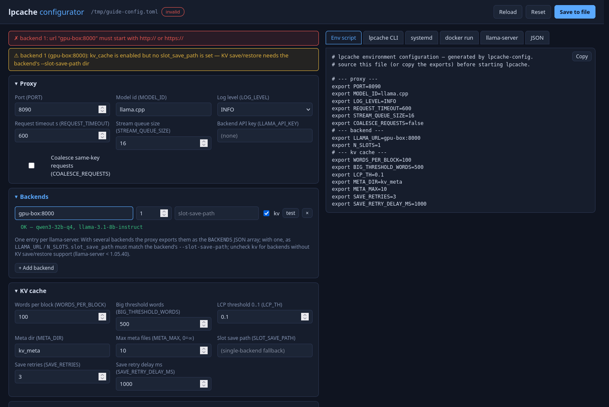

Plugin specs use the same banner — the offending entry is named (and, for a
nested filter, its index) — while the local check repeats under the field:

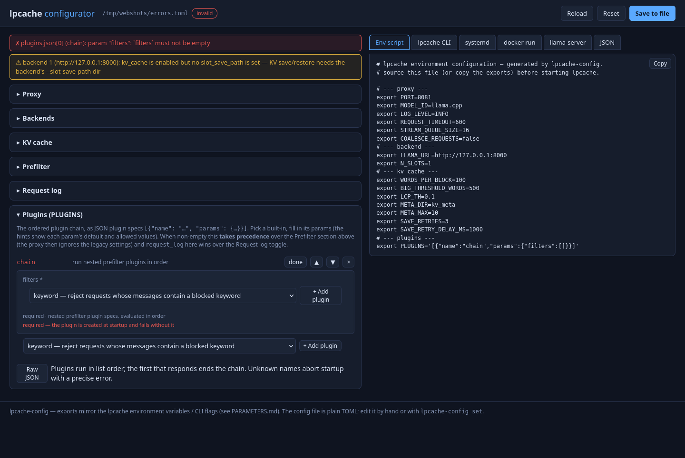

### Live export preview

The tabs on the right regenerate the selected export format from the
**in-memory** form state on every change — so you can see exactly what
`export systemd` would produce *while* you tweak fields, and copy it with
one click:

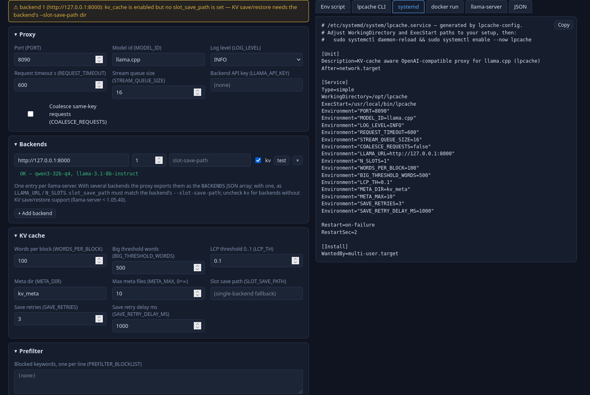

> The UI has no authentication — keep it on `127.0.0.1` (the default) or
> front it with a reverse proxy that adds auth.

## The PLUGINS section — every built-in and its params

In the TOML file the whole plugin chain is one string:

```toml
[plugins]
# a JSON *string* (escaped) holding an array of {"name": …, "params": {…}} specs
json = "[{\"name\": \"keyword\", \"params\": {\"keywords\": [\"spam\", \"ads\"]}}]"
```

- **Empty** (the `new` default) → the exports emit the legacy
  `PREFILTER_BLOCKLIST` / `PREFILTER_RESULT_CACHE_*` variables from the
  `[prefilter]` section instead of `PLUGINS`.
- **Non-empty** → only `PLUGINS` is emitted; the proxy then ignores the
  legacy prefilter settings, and a `request_log` spec in the chain wins over
  the `[request_log]` toggle (see
  [PLUGINS.md §2.2](../PLUGINS.md#22-plugins-vs-legacy-variables)).

From the command line:

```bash
lpcache-config set plugins.json '[{"name":"qwen_guard","params":{"url":"http://guard:8080"}}]'
lpcache-config get plugins.json
```

`set` saves immediately and *prints* any resulting validation errors/warnings
(it does not fail on them) — run `validate` to gate on them, or use the
wizard, whose **save & exit** refuses to write while errors exist.

### What `validate` checks

The checks mirror the plugin factories' startup validation
([PLUGINS.md §2.5](../PLUGINS.md#25-parameter-validation-and-startup-errors)),
so `validate` fails exactly on the specs that would make `lpcache` exit with
code 2:

| Error (fails `validate`, blocks the wizard's save) |
| --- |
| `plugins.json` is not a JSON array of `{"name": …}` objects |
| an unknown plugin name — with a *did-you-mean* suggestion for near misses |
| `params` present but not a JSON object |
| a missing (or empty) required param — `keyword.keywords`, `qwen_guard.url`, `result_cache.dir`, `chain.filters`, `llama.url` |
| a wrong type — a string where a number is expected, a quoted number, a float where an int is required, a non-boolean, … |
| a number outside its range — every `min ≥ 0` param, and the `dashboard` ranges below (range-validated, **not** clamped) |
| a value outside its allowed set — `on_error` / `on_unparseable`, the guard levels and categories, `cleanup`, every `request_log` field name |
| `request_log.fields` an explicit empty list, or a field repeated |
| `chain.filters` empty (the runtime refuses to start with an empty chain) |
| an invalid nested spec — reported as `filters[i]: …` so the offending filter is pinpointed; nesting deeper than 8 levels |
| a `dashboard` with **any** unknown param (it is the only built-in that deserializes with `deny_unknown_fields`) |
| a second `request_log` or `dashboard` spec (both are singletons) |
| a `dashboard.path` not starting with `/` |

| Warning (saved, but worth reading) |
| --- |
| a `llama` spec — backend clients are created automatically per backend, so it has no effect |
| unknown params on every plugin **except** `dashboard` — the runtime silently ignores them, so a typo'd name just runs the plugin's default |

### The built-ins and their params

Every param below is promptable in the wizard, formable in the web UI, and
checked by `validate` — all three share one schema table. `*` = required;
*omitted* means the key is left out of the JSON and the runtime default
applies (the wizard and web UI both drop values that equal the default).
Behaviour and worked examples:
[PLUGINS.md §3](../PLUGINS.md#3-built-in-plugins).

#### `keyword` — keyword blocklist prefilter

| param | type | default | notes |
| --- | --- | --- | --- |
| `keywords` * | string list | — | JSON array or comma-separated string; at least one entry |
| `case_insensitive` | bool | `true` | match keywords ignoring case |

#### `qwen_guard` — Qwen3Guard-Gen content-safety prefilter

| param | type | default | notes |
| --- | --- | --- | --- |
| `url` * | URL | — | guard server base URL; POSTs to `{url}/v1/chat/completions` |
| `api_key` | secret | — | sent as `Authorization: Bearer <key>` (masked in the web UI) |
| `model` | text | — | model id in the request; omitted = the server's default model |
| `timeout_secs` | int ≥ 0 | `30` | per-check timeout |
| `max_input_chars` | int ≥ 0 | `0` | cap on the text sent to the guard (0 = no truncation) |
| `reject_levels` | ci string list | `Unsafe` | `Safe` / `Controversial` / `Unsafe`; case-insensitive, comma string OK |
| `reject_categories` | ci string list | — | the nine harm categories; case-insensitive with aliases (e.g. `PII`, `Jailbreak`, `personally identifiable information`) |
| `on_error` | enum | `accept` | `accept` / `reject` (`allow` / `block` are aliases) — what to do when the guard call fails |
| `on_unparseable` | enum | `accept` | same values — what to do when the verdict is unparseable |
| `cache_max` | int ≥ 0 | `0` | LRU size for verdicts (accepts *and* rejects) keyed by the request cache key; 0 = off |

#### `result_cache` — file-based result cache + cached-result prefilter

| param | type | default | notes |
| --- | --- | --- | --- |
| `dir` * | text | — | cache dir holding the `{key}.json` entries (created on first write) |
| `ttl_secs` | float ≥ 0 | `300` | per-entry expiry; 0 = never expire (the runtime clamps negatives to 0 — the validator rejects them) |
| `cleanup` | enum | — | only `remove_after_serve` (delete an entry once served); omitted = none, anything else is a startup error |
| `cache_streaming` | bool | `false` | also cache streaming results and serve them to streaming clients |
| `cache_control` | bool | `false` | honor a `Cache-Control: no-cache` request header (bypass the cache) |

#### `chain` — run nested prefilters in order

| param | type | default | notes |
| --- | --- | --- | --- |
| `filters` * | nested specs | — | array of prefilter plugin specs, evaluated in order; **must not be empty** (a startup error); nesting deeper than 8 levels is a validation error |

#### `request_log` — W3C-XLF request logger (singleton)

| param | type | default | notes |
| --- | --- | --- | --- |
| `path` | text | `lpcache-request.log` | log file location; relative paths resolve against the proxy's cwd |
| `max_bytes` | int ≥ 0 | `10485760` | rotation threshold; 0 = no rotation |
| `keep` | int ≥ 0 | `5` | rotated generations kept; 0 = keep all |
| `fields` | string list | all 31 | ordered subset of the 31 known XLF field names; **blank / omitted = all 31** — an explicit `[]` or a repeated field is a startup error |

#### `dashboard` — real-time statistics web dashboard (singleton)

The only built-in that **rejects unknown params** (it deserializes with
`deny_unknown_fields`), and the only one whose numbers are **range-validated
rather than clamped**:

| param | type | default | notes |
| --- | --- | --- | --- |
| `path` | text | `/dashboard` | page URL path — must start with `/`; JSON stats at `{path}/api/stats` |
| `refresh_ms` | int 100..=3600000 | `2000` | page polling interval |
| `window_secs` | int 10..=86400 | `300` | trailing stats window |
| `bucket_secs` | int 1..=3600 | `5` | time-series bucket size |
| `max_recent` | int 0..=10000 | `100` | recent-requests ring size; 0 = no recent list |

#### `llama` — backend client (created automatically)

Not offered by the wizard's picker or the web UI's add menu: one `llama`
client is created per `[[backend]]` from that backend's `url` / `api_key`,
and a `llama` spec in `PLUGINS` has **no effect** (the validator warns). Its
params exist for reference and for custom registries: `url` * (URL),
`api_key` (secret), `timeout_secs` (float, default `600`) — **0 means no
per-request timeout**; the runtime clamps negatives to 0, the validator
rejects them.

## Exporting the configuration

Six formats, one command (`PATH` optional, same default file):

| Format | What you get |
| --- | --- |
| `env` | shell `export` lines — `source` before starting lpcache |
| `cli` | the equivalent lpcache CLI flags |
| `systemd` | a full unit file with `Environment=` lines baked in |
| `docker` | a `docker run` invocation with `-e` flags |
| `llama-server` | the flags each backend's llama-server must run with (`--slot-save-path`, parallelism, …) |
| `json` | the config as JSON (for tooling) |

```bash
lpcache-config export env > /etc/lpcache/lpcache.env
```

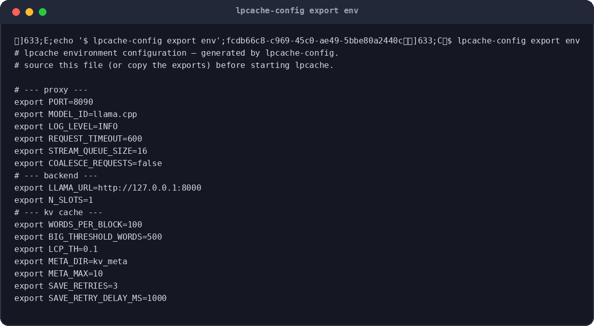

## Checking a backend without saving anything

`check` probes a backend from the command line — handy when a proxy
setup fails and you need to know whether the llama-server itself is
healthy:

```bash
lpcache-config check http://gpu-box:8000 --api-key secret
```

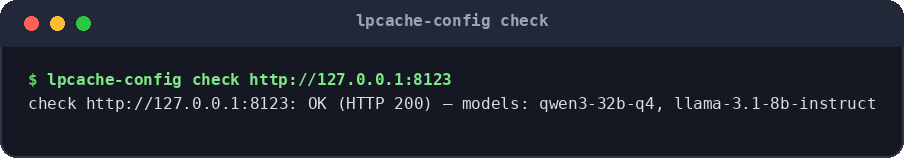

## Scripting & CI

Everything works non-interactively, so a config can be built in a
Dockerfile or CI job:

```bash
lpcache-config new -                          # defaults to stdout
lpcache-config set backend.url http://10.0.0.5:8000 deploy.toml
lpcache-config set prefilter.blocklist "politics,religion" deploy.toml
lpcache-config get --list                     # every dot-key that exists
lpcache-config validate deploy.toml || exit 1 # fails the build on errors
```

## Command reference

| Command | Purpose |
| --- | --- |
| `new [PATH]` | write a fresh defaults file (`-` = stdout, never overwrites) |
| `configure [PATH]` | guided menu (alias `wizard`) |
| `show [PATH]` | pretty-print the effective configuration |
| `get KEY [PATH]` | print one value (`get --list` enumerates all keys) |
| `set KEY VALUE [PATH]` | set one value and save (creates the file if missing) |
| `validate [PATH]` | validate; exit 1 on errors |
| `export FORMAT [PATH]` | print `env` / `cli` / `systemd` / `docker` / `llama-server` / `json` |
| `serve [--host H] [--port P] [-c PATH]` | web configurator (default `127.0.0.1:8086`) |
| `check URL [--api-key K] [--timeout S]` | probe a backend's `GET /v1/models` |
| `-h`, `--help` / `-V`, `--version` | help / version |

